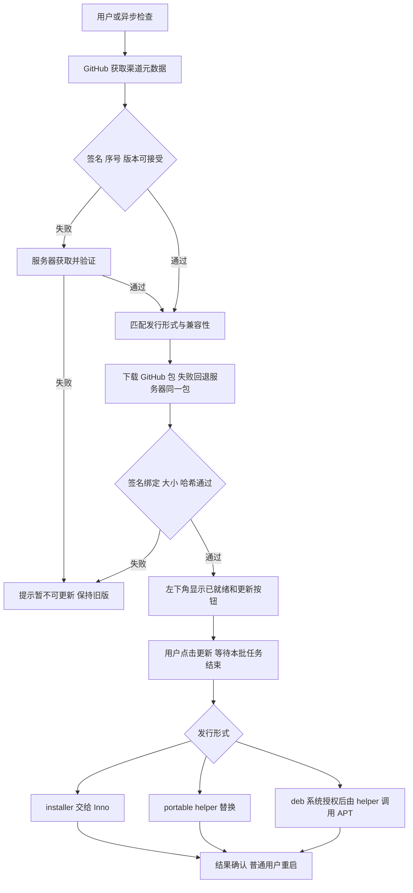

# 更新方案：Windows 与 Ubuntu/Debian

调研及决策更新日期：2026-10-11。状态：**决策已确认，更新功能以 1.7.6 验收与发布**。本文保留以 1.7.5 发行结构为基线的设计与决策；维护者已确认 D01–D12，包含 D03 的 Release 元数据入口和 D04 的本地签名/无短有效期方案。实现与发布步骤见 [更新开发与发布指南](application-update-development.md)，实际服务状态与测试结果见 [1.7.6 验收记录](validation-1.7.6.md)。11.2 为发布账户初次准备时的历史快照。

目标流程：**检查版本 → 下载新版本 → 校验完整性和来源 → 替换或安装 → 重启应用**。更新失败应保留可用的旧版本和用户数据，更新服务不可用不影响现有下载功能。

## 1. 已有调研和本次调整

仓库之前已有相关研究，并非从零开始：

| 本地资料 | 已有内容 | 本次需要补充或修订 |
| --- | --- | --- |
| [GUI 发行、安装与升级调研](gui-distribution-and-updates.md) | Inno、onefile、deb/APT、签名清单、helper、恢复；也比较了 MSI、MSIX、Qt IFW | 原文建议自有服务器优先，本次按维护者要求改为 GitHub 优先；确定域名、目录、双源一致性和运维责任 |
| [GUI 构建与发行](gui-build-and-release.md) | Windows 两种包、Linux deb、八项发行集合、SHA256 | 接入更新清单、签名、服务器镜像及 APT 索引的发布步骤 |
| [GUI 技术评估](gui-technology-evaluation.md) | 提出检查更新、完整包下载、任务结束后安装 | 细化退出、托盘、权限和安装形式识别 |
| [持续测试规范](testing.md)、[1.7.0 记录](validation-1.7.0.md) | 手动跨版本升级、安装失败恢复和降级边界 | 补充更新事务定向验收；历史通过不能当作自动更新已经通过 |
| [1.7.5 记录](validation-1.7.5.md)、[版本规划](roadmap.md) | 当前发行和关闭进入托盘的行为；自动更新独立排期 | 更新必须执行真正退出，不能只隐藏窗口 |

本次更新功能的源优先级、域名和路径建议以本文为准；原调研中平台比较仍可参考。此前没有实现应用内更新或建立 APT 源。

### 1.1 当前代码可复用的基础

- Windows 安装版：Nuitka standalone + Inno Setup；稳定 AppId，默认当前用户安装到 `%LOCALAPPDATA%\Programs\BiliX`，`PrivilegesRequired=lowest`。已有安装版本比较、拒绝降级和 `runtime.previous` 安装失败恢复逻辑。
- Windows 绿色版：Nuitka onefile EXE，包含运行时和 FFmpeg；构建没有指定固定的 onefile 缓存路径，需核对外壳与解包后进程的实际生命周期。
- Linux：包名 `djhx-bilix-gui`，架构 `amd64`；Ubuntu 22.04 构建基线，当前文档验收范围为 Ubuntu 22.04/24.04、Debian 12/13。程序由 dpkg 管理，系统 FFmpeg 由依赖提供。
- `scripts/gui_release.py` 生成的 `release-manifest.json` 目前只有版本、文件名、大小和 SHA256；没有更新渠道、兼容性约束或发布签名。现有构建/打包脚本没有配置 Windows 代码签名。
- 配置、token、GUI 偏好和下载文件在用户目录；更新程序文件不需要移动这些数据。当前队列、草稿和历史不跨重启保存。
- GUI 标题栏关闭默认进入托盘；文件/托盘菜单退出才会停止并等待工作线程。更新须增加明确的退出原因和退出握手。

上述是实施前核对的发行基础。官网和关于窗口已统一到维护者指定的 `https://bilix.djhx.site`；实际更新与平台验收进度单独记入开发指南，不能用历史下载验收代替更新验收。

## 2. 已确定的需求与推荐边界

维护者已确定：Windows 同时支持 installer 和 portable；Ubuntu/Debian 保留直接下载 deb，并研究自建 APT 源；正式产物和校验文件同时托管 GitHub Releases 与 `bilix.djhx.site`；应用直接更新采用 **GitHub 优先、自有服务器备用**；版本 JSON 部署在自有服务器。

首期已确定：**GUI 全量更新、轻量元数据签名、不购买 Windows 代码签名证书、发现新版自动下载、用户点击更新才安装**。自动检查开关默认开启，每次启动检查一次，运行期间每 30 分钟检查一次。CLI 自动更新不做，以后再考虑。Windows 沿用 Inno + onefile，Linux 点击更新后自动发起系统提权授权，不做差量、强制更新或重启系统。[Inno 升级身份](https://jrsoftware.org/ishelp/topic_setup_appid.htm)、[APT 安全模型](https://manpages.debian.org/trixie/apt/apt-secure.8.en.html)

| 发行形式 | BiliX 负责 | 替换/安装负责方 | 应用重启 |
| --- | --- | --- | --- |
| Windows installer | 自动检查/下载 Setup/验证；用户点更新，等待任务结束并真正退出 | 新版 Inno 安装器 | 安装成功后以原普通用户启动，只有一个重启执行者 |
| Windows portable | 自动检查/下载 EXE/验证；用户点更新，协调退出 | 独立 helper 替换当前外部 EXE，保留上一版 | helper 启动新 EXE并做简单结果检查 |
| Linux deb，GUI 内更新 | 双源自动下载并验证 deb；用户点更新后发起系统授权，停止应用工作 | 固定提权 helper 调用 APT/dpkg | 普通用户协调器在成功后重启 GUI |
| Linux deb，系统 APT/手动更新 | 保留自建源和直接下载 deb 的入口 | 用户/系统通过 APT 升级或 `apt install ./文件.deb` | 用户正常重新打开 |
| pip/源码运行的 GUI | 识别为外部管理方式，显示对应更新说明 | pip、环境管理器或用户 | 不使用 GUI updater 覆盖 Python 环境 |

CLI 保持现有手动升级方式，不增加后台版本检查或自动下载。Python 环境运行的 GUI 首期不自动覆盖环境。旧客户端不回补 updater，也不额外兼容不受支持系统；README 已加入一句告知，安装时仍应拒绝错架构或明显不兼容的包。

### 2.1 已确认的界面与触发行为

- 设置增加“自动检查更新”，默认开启。开启时，每次启动异步检查一次，之后每 30 分钟检查；窗口在托盘时仍按此频率执行。关闭后停止周期检查和由新检查触发的自动下载，保留手动“检查更新”入口。
- 每次检查发现匹配当前安装形式的新版本后，自动下载本平台更新包及必要的签名/清单；不等待用户先点击下载，不下载其他平台的发行文件。
- **左下角状态区**显示“正在下载更新 · XX%”，大小未知时显示已下载字节；下载完成后先校验，通过才显示“新版本已就绪”和“更新”按钮。界面不得把仅下载完但未通过校验的包标成可安装。
- 同一候选版本正在下载或已验证就绪时，后续 30 分钟检查不重复下载。校验后的缓存可复用，失败使用有限重试/退避；升级候选变化时更新按钮对应准确的目标版本。
- 自动准备不打断媒体下载、不触发安装/提权。用户点击“更新”后才开始安装事务；有本批任务时默认等整批结束，再退出和安装，不强杀下载。
- Linux 下载准备指本项目更新包和元数据；缺少的系统依赖由 APT 在授权安装时解析/获取，因此“更新包已就绪”不承诺完全离线安装。管理员授权取消、下载取消或权限不足时保留旧版及可复用的已验证缓存。
- 首期安装交互仍建议 Windows 保留安装进度/向导；是否进一步静默是后续体验优化，不阻塞当前文档。重启的是应用，禁止自动重启系统。

## 3. 域名、目录和文件命名

固定公开根地址：`https://bilix.djhx.site`。建议使用 **`/releases/` 保存不可变版本文件、`/updates/` 保存更新渠道元数据、`/apt/` 保存 APT 仓库**。这是根据 GitHub 的版本化 Release 和 Debian 仓库结构作出的项目命名选择，不存在统一规定必须叫 `release` 或 `download` 的标准。[GitHub Release 链接](https://docs.github.com/en/repositories/releasing-projects-on-github/linking-to-releases)、[APT 源 URI 与 suite](https://manpages.debian.org/trixie/apt/sources.list.5.en.html)

网站根目录已经独立服务 BiliX，无需再加 `/bilix/`。`/download/` 如以后作为网页入口，只做导航，不作为客户端依赖的安装包身份。

```text
/var/www/bilix.djhx.site/
├── index.html
├── updates/
│   ├── stable.json                 # 可更新的稳定渠道描述
│   ├── stable.json.sig
│   └── keys/                      # 公钥、指纹及轮换资料，不存私钥
├── releases/
│   └── vX.Y.Z/
│       ├── update-manifest.json    # 不可变版本清单
│       ├── update-manifest.json.sig
│       ├── stable.json             # D03 方案 A：该次发行的渠道描述快照
│       ├── stable.json.sig
│       ├── release-manifest.json   # 保留现有发行集合清单
│       ├── SHA256SUMS.txt
│       ├── BiliX-GUI-Setup-X.Y.Z-windows-x64.exe
│       ├── BiliX-GUI-Portable-X.Y.Z-windows-x64.exe
│       ├── djhx-bilix-gui_X.Y.Z-1_amd64.deb
│       └── ...                    # 同版其余源码、许可、CLI、Python 产物
└── apt/
    ├── dists/stable/
    │   ├── InRelease
    │   ├── Release
    │   ├── Release.gpg
    │   └── main/binary-amd64/
    │       ├── Packages[.gz/.xz]
    │       └── by-hash/SHA256/...
    └── pool/main/d/djhx-bilix-gui/...
```

`X.Y.Z` 为说明用占位符，不是已发布版本。第一阶段只开放 stable；预览渠道需要独立 JSON、安装身份及明确的用户选择，不能由 stable 自动切换。

例如同一 Windows 包的两个下载位置应为：

```text
https://github.com/Koril33/bilix/releases/download/vX.Y.Z/BiliX-GUI-Setup-X.Y.Z-windows-x64.exe
https://bilix.djhx.site/releases/vX.Y.Z/BiliX-GUI-Setup-X.Y.Z-windows-x64.exe
```

两个位置必须提供**逐字节相同**的文件，保持现有文件名。GitHub 上的不可变版本清单、签名和校验文件也放在同版 Release。APT pool 的 deb 与上述 deb 必须相同，可用硬链接/受控复制减少服务器存储，但不能修改 deb 内容。

## 4. 检查版本与双源回退

### 4.1 区分渠道描述与版本清单

- **渠道描述**回答“现在 stable 推荐哪个版本”，包含递增元数据序号、生成时间、版本清单位置和哈希。首期不设强制短有效期，随正式发行切换，无每周重签任务。
- **版本清单**回答“该版本有哪些经过授权的文件、兼容性和安装方式”，发布后不覆盖，记录来源版本、包版本、架构、大小、哈希和两个下载位置。
- HTTPS 提供传输保护，签名确认发布授权，SHA256 确认下载字节与清单一致。三者不是相互替代关系。

区分两者后，如选择短有效期，就可以刷新渠道描述而不重打包同版程序；不设短有效期时无需周期重签。当前 `release-manifest.json` 保留原用途，新更新协议使用独立文件，避免把历史发行清单误认为更新协议。

### 4.2 GitHub 元数据入口：D03 已确认

D03 问的是：**客户端去 GitHub 的哪个地址找“目前最新版是谁”，以及这份小 JSON 是否要在没有新版本时刷新。** 安装包的下载地址没有争议，仍是 GitHub 优先、服务器备用。

维护者已批准 **A：每个正式 Release 附 `stable.json` 和 `stable.json.sig`，服务器 `/updates/stable.json` 保存相同内容**。GitHub 提供 latest 资产入口，每次新版本发布才切换到新 JSON，不增加专用控制 Release：

```text
A 主入口：https://github.com/Koril33/bilix/releases/latest/download/stable.json
A 备用：  https://bilix.djhx.site/updates/stable.json
```

与已批准的 D04 配套，首期不设需要周期刷新的短有效期。各版本 Release 中的 JSON 和安装包保持不变；发布时先准备所有产物/签名，最后切换 latest 与服务器入口。GitHub 官方支持 latest 资产地址。[GitHub latest 下载链接](https://docs.github.com/en/repositories/releasing-projects-on-github/linking-to-releases)

之前讨论的 B（可编辑 `updates-stable` 控制 Release）本期不实施。GitHub 不可变 Release 发布后不能追加或替换资产，因此四份元数据/签名须与安装包一起加入草稿，再发布。服务器必须独立提供同样的清单、签名和完整安装包。[GitHub 不可变发行](https://docs.github.com/en/code-security/concepts/supply-chain-security/immutable-releases)、[资产 API](https://docs.github.com/en/rest/releases/assets)

GitHub latest API 可作为网页和辅助发现入口，不能替代签名校验；未认证 REST 请求通常按来源 IP 每小时 60 次，共享 IP 和频繁轮询容易触及限制。客户端不内置 GitHub Token，也不把 Bilibili 凭据带到更新请求。[GitHub API 限额](https://docs.github.com/en/rest/using-the-rest-api/rate-limits-for-the-rest-api)

### 4.3 回退规则

1. 获取 GitHub 渠道描述及签名，验证成功后选择版本；连接、DNS、TLS、超时、限流、404/5xx、格式错误或签名无效时，将该源标记失败，尝试服务器的完整描述和签名。
2. 验证器只接受内置可信密钥签署、序号不倒退且兼容的描述；相同序号的描述也必须保持原字节。备用源无法满足同样条件就停止检查，不执行未经验证的更新。首期没有基于过期时间的冻结检测。
3. 按描述中的 `manifest_urls` 依次获取不可变版本清单及签名，核对描述绑定的大小/哈希，再验证清单签名、产品与版本。主源失败仍可从备用取得同一清单。之后按清单中的 GitHub URL 下载选定包；GitHub API 可访问但资产 CDN 不可访问，也要回退到服务器。
4. 文件连接失败、下载停滞或大小/SHA256 不符时，删除该来源的临时包，再从另一位置下载**同一个文件、同一个版本、同一个期望哈希**。不得拼接不同镜像的 `.part` 文件或临时改选另一版本。
5. 两源处于发布切换窗口时，以一份完整验证通过的描述和清单完成事务；已见过较高序号的客户端拒绝较旧备用描述，提示稍后重试。首版不并行竞速，不保证每次检查都比较两个源的最新程度。

签名失败属于来源验证失败，应有可诊断记录；允许尝试另一独立来源，但绝不通过关闭签名、TLS 或哈希校验来“解决”。网络失败显示“暂时无法检查”，不能显示“已经是最新版”。

检查频率已确定为自动开关默认开启、每次启动检查一次、之后每 30 分钟检查一次；手动检查可立即触发。启动/定时/手动检查共用一个进行中的检查，不并发重复请求，并缓存已验签结果；关闭自动检查不影响手动入口。超时仍建议元数据每源总预算约 15 秒、连接约 5 秒，大包使用约 30 秒无进展超时；一次回退后结束，失败退避。这些网络时限由实施时调优，不再把检查频率列为待决策。

## 5. 完整性、签名与信任基础

### 5.1 已确认采用轻量签名

**维护者已确定首期使用轻量签名，不引入 TUF。** 采用成熟 Ed25519 库签署元数据，SHA256 绑定文件完整性；TUF 只保留为后续能力比较。D04 已确定本地仓库外私钥、受保护备份、无强制短有效期。[Ed25519 官方库文档](https://cryptography.io/en/latest/hazmat/primitives/asymmetric/ed25519/)

| 选择 | 接入与维护判断 | 本项目需要承担的部分 |
| --- | --- | --- |
| 轻量签名清单 | 文件少，初次接入较小；长期维护成本取决于自行定义的信任/轮换协议 | schema、原始字节签名、渠道新鲜度、双源一致性和恢复规则全部需冻结 |
| TUF 客户端与标准仓库 | 初次接入较多，但可复用标准验证及信任角色 | 根/时间戳/快照/targets 元数据的发布、密钥策略和双源获取适配；不再维护一套自称 TUF 的简化协议 |

上述比较仅保留调研背景，两者都不负责运行 Inno、替换 onefile 或执行 APT。轻量库接入时核对 Python 3.11、Nuitka 两种 Windows 包及 GUI 可选依赖边界，不把更新依赖无意加给纯 CLI 用户。这里的难度判断不是已经测出的工时。

如果采用轻量方案，建议 detached 签名覆盖 JSON 文件**原始 UTF-8 字节**，客户端先验证再解释字段；不要重排 JSON 后再验签。`.sig` 容器、key ID、算法标识、是否支持多签及公钥编码必须冻结协议并给出测试向量。一次请求限制元数据体积，例如 256 KiB，并拒绝重复键、不支持的 schema 和不合法的路径。

公钥随首次具备更新功能的正式客户端交付；从网络下载公钥不能自行提升为可信。key ID 只能选择已有信任集合。首次安装仍依赖用户对原始安装包渠道的信任，更新机制不能倒过来证明最初安装包可信。

签名私钥由本地发布电脑在仓库外保管，并保留受保护备份；公网 Web 根目录只放公钥和签名。每次正式发行在本地签名，不把私钥放在 Web 服务器上，不建立周期重签任务。

### 5.2 三类签名分别处理

| 验证层 | 验证什么 | 推荐处理 |
| --- | --- | --- |
| 更新元数据签名 | 发布者授权的版本、文件哈希和兼容条件 | Windows 自动安装、绿色替换及应用下载 deb 都必须验证 |
| Windows Authenticode | EXE/helper/Setup 的 Windows 发布者和文件签名 | 已决定首期不购买证书、不配置此签名；不作为首版门槛 |
| APT OpenPGP 仓库签名 | InRelease/Release 到 Packages、deb 哈希的信任链 | 自建 APT 源必需；使用专用仓库密钥和 Signed-By |

首期 Windows 依靠内置公钥验证更新元数据及文件哈希，不要求 Authenticode，系统仍可能显示未知发布者/SmartScreen 提示。开源免费与元数据签名不冲突：Ed25519 密钥自行生成，无需购买 Windows 证书。若以后增加代码签名，须签后再计算最终 SHA256，并用 `WinVerifyTrust` 核对预期发布者。[SmartScreen 声誉](https://learn.microsoft.com/en-us/windows/apps/package-and-deploy/smartscreen-reputation)、[WinVerifyTrust](https://learn.microsoft.com/en-us/windows/win32/api/wintrust/nf-wintrust-winverifytrust)

APT 通常验证仓库元数据及包哈希，不是要求每个 deb 自带同一种签名。**对手动下载的本地 deb 执行 `apt install ./文件.deb`，并不会自动完成 BiliX 发布者验证**；安装前仍应验证更新清单和包哈希。[apt-secure 信任链](https://manpages.debian.org/trixie/apt/apt-secure.8.en.html)

### 5.3 D04 已确认：谁能签更新，以及多久需要维护

D04 与 SSH 账号密码、Windows 证书不同，包含两类决定：**发布更新用的签名私钥由谁保存；JSON 是否设有效期，导致没发新版本时也要重签。** 公钥可公开并内置客户端，私钥只能由发布者掌握。

维护者已确认的首期方案：

- 更新签名私钥在维护者本地发布电脑的仓库外保存，另做一份受保护备份；服务器只放公钥/签名，`bilix` SSH 发布账号也不持有此私钥。应用更新签名密钥与 APT GPG 密钥分开，具体文件位置和工具在实施时确定。
- 每次正式发布时签 JSON 和版本清单。**应用更新 JSON 首期不设强制短有效期**，不建立每周重签任务；与 D03 的方案 A 配套，避免增加持续运维。若改为 30 天有效期，就必须即使没有新版本也按期刷新，D03 需支持可编辑元数据。
- 保留基本版本比较和可信序号记录，防止自动降级；项目版本、Debian 包修订分开比较。无有效期方案可以确认发布授权及文件未被修改，但无法防止攻击者长期提供仍有合法签名的旧清单，不能宣称它证明“这一定是全网最新版本”。
- 首期不做在线根密钥自动轮换。正常换钥可在仍受信的新版程序中带入新公钥；密钥丢失或失陷时人工发布说明、由用户安装可信新版恢复，不信任未验证 JSON 下发的新公钥，也不继续用已泄漏私钥自证安全。
- 维护者已决定不兼容旧客户端恢复链，不为长期离线旧版增加复杂迁移协议。未来需要更强的防冻结、在线轮换和失陷恢复时再评估 TUF。

有效期与轮换的能力边界可参考 [TUF 概述](https://theupdateframework.io/docs/overview/)，这不表示首期采用 TUF。**D02、D04 均已确认**。应用更新 Ed25519 公钥 ID 为 `bilix-ed25519-d9accaf9f50348e6`；独立 APT GPG 密钥已生成并备份，保管与恢复验证见开发指南。SSH 发布密钥不作为更新信任根。

## 6. 元数据与客户端契约

首期协议已冻结为 schema 1、签名容器 format 1，详细字段与示例见开发指南。发布工具从最终发行集合导入真实哈希，覆盖源码/许可和 CLI/Python 文件；客户端自动更新仅支持三种 GUI 发行形式，CLI 不增加自动更新。

| 文件 | 必要字段 | 含义 |
| --- | --- | --- |
| stable.json | schema、product=`bilix`、channel=`stable`、metadata_sequence、issued_at、release_tag | 防错产品、错渠道和序号倒退；首期无 expires_at，不能限制长期冻结时间 |
| stable.json | version、manifest_sha256、manifest_bytes、manifest_urls | 绑定具体不可变版本清单；URL 顺序 GitHub、服务器 |
| update-manifest.json | schema、product、version、release_tag、published_at、release_notes_url | 应用身份、版本和说明；发行说明作为普通文本/受控链接 |
| update-manifest.json | min_updater_schema、config_compatibility、artifacts | 老客户端能否处理；配置迁移风险 |
| artifacts[] | artifact_id、platform、arch、package_type、install_scope、package_version | 精确区分 installer/portable/deb，不根据文件扩展名推断 |
| artifacts[] | filename、bytes、sha256、urls、os_constraints | 固定目标文件、双源地址、系统兼容性；必须有真实哈希 |
| 签名文件 | format、key_id、algorithm、signature | 格式冻结后覆盖上述文件原始字节 |

清单不下发任意 shell 命令、安装参数或本地目标路径。客户端只使用自身固定的安装动作，限制 HTTPS 来源及重定向规则；允许 GitHub 实际资产 CDN，具体允许范围需验证，不能简单禁止一切跨域重定向。清单中的文件名必须是单个安全名称，禁止 `../`、绝对路径和未授权目标目录。

发行形式必须由**构建时身份 + 安装器记录/包管理器记录**确认。建议三类 artifact ID：`windows-x64-installer`、`windows-x64-portable`、`linux-amd64-deb`。用户移动/改名 portable EXE 后仍须识别；onefile 解包目录不是更新目标。身份不明确时只提供手动说明，不试探覆盖。

deb 的包修订可能从 `X.Y.Z-1` 变为 `X.Y.Z-2` 而应用版本不变，APT 应能识别这种更新；Windows/应用版本提示不得凭应用版本相同就丢掉 Linux 包修订。版本规则和兼容性比较应共享明确契约，包管理器自己的版本策略仍由它管理。[Debian 版本比较](https://manpages.debian.org/trixie/dpkg/dpkg.1.en.html)

同应用版本重新发行包修订时，使用新的发行标签和目录（例如 `vX.Y.Z-r2`），JSON 中应用版本仍为 `X.Y.Z`、包版本为 `X.Y.Z-2`；不能覆盖原 `vX.Y.Z` 的文件。客户端按清单字段比较，不直接把 Release 标签当作应用版本解析。

## 7. Windows 安装版流程

1. 识别稳定 AppId、当前用户安装范围、安装路径与已安装版本，选中 installer 产物。
2. 发现新版后自动将本平台 Setup 下载到用户更新缓存的 `.part`，完成轻量元数据签名、大小和 SHA256 检查；首期不要求 Authenticode。安装之前不改现有目录。
3. 左下角显示下载进度，通过校验后显示“更新”按钮；用户点击才开始安装。有活动下载时默认等待**本批全部完成**，不在当前视频结束后抢占剩余队列。
4. 就绪后阻止新操作，保存偏好；如用户明确取消下载并更新，调用现有协作取消并等待工作线程/FFmpeg 结束。草稿或会话历史会随退出丢失，必须说明；本期不伪造队列持久化。
5. helper/升级协调器移至独立缓存目录，使用简单退出标记及进程等待，确认当前 GUI 和子进程结束后启动已验证的 Setup。同路径其他实例未退出时提示用户关闭后重试，不实现复杂跨实例协调。安装执行前再次校验缓存包。
6. 首版建议保留安装向导和进度，传 `/NORESTART`；需要捕获安装结束状态和系统重启需求。安装失败/取消恢复可用旧程序，并展示可读结果。
7. 只有安装成功且新版本检查通过，才以原用户启动新程序；避免安装器 `[Run]` 与 helper 同时启动两次。当前 `[Run]` 有 `postinstall skipifsilent`，实施时需要明确谁负责启动。

现有 Inno 使用 `CloseApplications=yes`、`RestartApplications=no`；Restart Manager 不能替代 BiliX 的工作线程和 FFmpeg 退出。首期做基本更新互斥、进程等待和文件占用拒绝，必要时使用 `AppMutex`；完整跨副本协调后置。[CloseApplications](https://jrsoftware.org/ishelp/topic_setup_closeapplications.htm)、[AppMutex](https://jrsoftware.org/ishelp/topic_setup_appmutex.htm)

如果后续采用静默安装，必须另外冻结 `/SILENT` 或 `/VERYSILENT`、`/NORESTART`、`/RESTARTEXITCODE`、日志及重启控制；没有 `/NORESTART` 的 very silent 模式可能直接重启系统。参数的退出码不是 MSI 的退出码，不可混用。当前安装器无需 `/CURRENTUSER` 强行切换范围；该参数仅在脚本允许覆盖安装模式时生效。[Inno 命令行](https://jrsoftware.org/ishelp/topic_setupcmdline.htm)

**恢复策略已确认：**安装失败沿用受控的 `runtime.previous` 恢复；安装成功但新程序启动失败是另一种结果，首期保留诊断及旧安装器获取入口，提供人工恢复说明，不宣称安装器会自动回滚启动失败。当前降级保护不能被普通更新绕过，必要时人工卸载新安装版后重装经验证旧包，用户数据保持独立。配置格式迁移前备份需要迁移的 `config.toml`/`gui.ini`，不为程序更新复制 token；备份至少保留到下一次成功更新。断电/强杀下的完整安装事务恢复后置，不把已有受控失败验证扩大成任意失败承诺。

## 8. Windows 绿色版流程

1. 确认实际外部 EXE 的绝对路径和 portable 身份；下载目标仍可以叫 `BiliX-GUI-Portable-X.Y.Z-windows-x64.exe`，安装到本地时替换用户正在使用的**原文件名**，保留其快捷方式。
2. 发现新版后自动下载并验证到独立 staging；左下角显示进度，通过校验后开放“更新”按钮。helper 来自可信程序/受验证版本，并复制到不会随 onefile 清理的目录；用户点击才启动替换事务。
3. 目标目录可写、空间充分后，在目标同一文件系统准备完整 `.new` 文件，再次验证；考虑下载缓存、旧 EXE、新 EXE 和新版解包空间，不能只按单包大小预估。
4. 采用简单更新锁与进程等待，确认 GUI、onefile 外壳和关联 FFmpeg 结束；发现同一路径其他实例/占用时提示关闭后重试，不实现跨实例自动关闭，不误杀其他路径的副本。
5. 保留旧 EXE 为受控备份，再替换新文件。单次同盘 rename 可作为事务步骤，但“旧文件移走 + 新文件移入 + 重启”整体不是一个原子事务，必须有持久事务状态和中断恢复。
6. helper 启动原路径新 EXE，先使用简单本地结果标记核对目标版本和初始化成功，捕获启动异常/早期退出；复杂 nonce/IPC 和多实例握手后置。不能仅因替换文件成功就显示应用更新成功；失败保留备份并提供恢复入口，不无限自动回滚。
7. 保留上一版 EXE，下一次成功更新才替换该备份；迁移配置前另做备份。恢复旧程序前关闭新进程，不假定新配置能直接被旧程序读取。

Nuitka onefile 存在外壳及解包后的运行位置；文件更新必须针对外部 EXE，文件路径和进程退出要按实际构建验证。[Nuitka onefile](https://nuitka.net/user-documentation/use-cases.html)、[Nuitka 路径说明](https://nuitka.net/user-documentation/common-issue-solutions.html)

目标在只读目录、网络盘、受保护目录或权限不足时，首版回退为“下载已验证文件 → 打开文件夹 → 手动替换”，不自动提权。文件占用、安全软件干预和替换失败要有有限等待和恢复提示；不使用“系统重启后替换”冒充立即更新完成。[Windows 移动与替换文件](https://learn.microsoft.com/en-us/windows/win32/fileio/moving-and-replacing-files)

## 9. Ubuntu/Debian：签名 APT 源与本地 deb

### 9.1 可行性与源优先级的例外

**可行，现有静态 HTTPS 站点足够承载 APT 仓库。** 需要增加索引、仓库签名、公钥分发和发布流程，而不需要常驻更新后端。推荐沿用当前包名和 amd64，初期共用 BiliX 自己的 `stable/main` suite；这里的 stable 是 BiliX 渠道，不表示只支持 Debian stable。

共享 suite 的前提是同一个 deb 已验证兼容当前四个目标系统及其 Depends。原调研建议按发行版代号划分；本次基于已有共享包建议先用单一 stable，若以后依赖或 glibc 基线分叉，再提供 jammy/noble/bookworm/trixie 等 suite 并明确迁移，不往旧系统悄悄推不兼容包。

APT 的索引和包获取走 `https://bilix.djhx.site/apt/`，**不执行“GitHub 优先”**。GitHub Release 资产不是完整的 APT 仓库；把 GitHub 填成源或把 JSON 源回退逻辑套给 APT 不可行。GitHub 优先规则适用于应用直接下载和手动 deb 下载。若 APT 服务器不可用，用户仍可从 GitHub 下载签名清单和 deb 后本地安装。[APT 仓库与认证](https://manpages.debian.org/trixie/apt/apt-secure.8.en.html)

### 9.2 建源工具和发布格式

建议评估 **aptly 的本地 repo + snapshot + publish/switch**，小型仓库也可用 reprepro。aptly 提供快照切换及 `-acquire-by-hash`，有利于避免发布切换或缓存引起的索引哈希不匹配；不是要求运行其 API 服务。只使用已验证的工具版本，密钥与快照保留策略在实施前固定。[aptly 发布快照](https://www.aptly.info/doc/aptly/publish/snapshot/)、[aptly 切换快照](https://www.aptly.info/doc/aptly/publish/switch/)

仓库需要 `Packages` 及压缩索引、`Release`、签名 `InRelease`，可同时提供 `Release.gpg`；包路径在 pool。设置明确的 Origin/Label（例如 BiliX）、Suite/Codename、Components、Architectures，只发布本项目包和必要的 keyring 包，避免向系统基础包提供候选版本。快照切换时要核对默认清理行为，必要时使用 `-skip-cleanup` 或先复制保留旧索引/包，不能切完快照就删除仍被旧客户端引用的文件。

APT 签名私钥与应用更新签名私钥分开。D04 已确定首期不强制短 `Valid-Until`，不引入每周重签任务；保持仓库签名和索引/包哈希验证，客户端不关闭 APT 默认安全检查。旧 by-hash 索引与 pool 包保留，后续清理须独立评估，不能只因用了工具就宣称已防冻结。[APT Valid-Until](https://manpages.debian.org/trixie/apt/sources.list.5.en.html)

### 9.3 用户首次配置示例

APT 索引与公钥现已部署，四发行版实际验签及升级通过。完整首次安装命令见 [更新使用指南](gui-updating.md)，下方保留源配置格式。公钥完整指纹为 `201A20E104EF3C72CE573F7E61323BAA3BB87821`，GitHub 文档与官网同时公布；这是渠道一致性核对，不能替代最初的信任判断。后续可用单独 `bilix-archive-keyring` 包管理轮换。

将经核对的 ASCII-armored 公钥放到 `/etc/apt/keyrings/bilix-archive-keyring.asc`（目录 0755、文件 0644，使 `_apt` 可读），创建 `/etc/apt/sources.list.d/bilix.sources`：

```text
Types: deb
URIs: https://bilix.djhx.site/apt/
Suites: stable
Components: main
Architectures: amd64
Signed-By: /etc/apt/keyrings/bilix-archive-keyring.asc
```

采用独立 Signed-By，不使用全局 `apt-key add`、`trusted=yes` 或允许不安全仓库。ASCII 公钥用 `.asc`，二进制导出公钥用 `.gpg`，不要把 GnuPG 私有 keybox 直接当公开 keyring。[APT 密钥位置与格式](https://manpages.debian.org/trixie/apt/apt-secure.8.en.html)

建立源之后，日常操作可以是：

```bash
# 和系统其他软件一起升级（可能涉及其他软件，不是只更新 BiliX）
sudo apt update && sudo apt upgrade

# 只升级已安装的 BiliX
sudo apt update && sudo apt install --only-upgrade djhx-bilix-gui

# 首次安装
sudo apt update && sudo apt install djhx-bilix-gui
```

hold、APT pinning、包候选版本及依赖冲突仍可能阻止升级；加源也不等于自动启用 unattended-upgrades。用户若仅想更新 BiliX，GUI 不应代其执行全系统 upgrade。[apt 的 update/upgrade](https://manpages.debian.org/trixie/apt/apt.8.en.html)

### 9.4 本地 deb 的永久备用入口

从 GitHub 优先、服务器备用下载新版 deb 及受信签名清单，验证后关闭 BiliX，用户执行：

```bash
sudo apt install ./djhx-bilix-gui_X.Y.Z-1_amd64.deb
```

不需要先卸载旧版本；APT 可解析可获得的系统依赖。不能假定本地安装会验证本项目发布签名，也不能假定依赖可以在完全离线时获得。没有加 BiliX 源时，之后仍需手动下载安装新 deb。[Ubuntu 软件包管理](https://documentation.ubuntu.com/server/how-to/software/package-management/)

### 9.5 GUI 点击更新与自动发起系统提权

维护者已要求首期提供 Linux 一键更新：**自动下载 deb → 验证就绪 → 用户点击更新 → 系统授权 → APT 安装 → 普通用户重启 GUI**。无需用户手动输安装命令，仍保留 APT 源、手动 deb 和安装说明作为备用。

自动提权指应用主动调用 polkit/pkexec，系统授权代理按系统策略请求管理员身份；不是绕过授权或要求 GUI 收集 sudo 密码。GUI 和重启协调器以普通用户运行，只有固定安装 helper 获得 root。用户取消授权则不安装；pkexec 在授权被取消时提供可区分的退出码。[pkexec 官方说明](https://polkit.pages.freedesktop.org/polkit/pkexec.1.html)

建议首期实现步骤：

1. 正式 deb 安装一个 root 所有、普通用户不可修改的安装 helper 及对应 polkit action，核对并声明各目标系统的 pkexec/授权依赖；不授权从用户缓存执行任意脚本，不把整个 GUI 改成 root。
2. 选择的 deb 已自动下载/验签/校验。用户点更新后，如有本批任务先等批次结束；普通用户协调器再请求系统授权。授权取消保持旧应用可用。
3. helper 核对固定产品、公钥签名、版本和 deb 身份，把候选复制到 root 控制的暂存位置后再次核验，避免验证之后可写缓存被替换；只允许安装 BiliX，不接受任意 shell 命令。
4. 真正退出当前 GUI 并等待下载线程/FFmpeg结束，检测到其他实例占用就提示用户处理。helper 调用固定路径的 `apt-get` 安装该本地 deb，由 APT 处理依赖和包管理锁，不自行覆盖 `/usr`。已下载 deb 不能再次依赖 GitHub 在线校验才能安装。
5. root helper 返回可读安装结果；普通用户协调器负责重新启动及简单版本/启动结果检查，安装成功前不显示完成，root/helper/deb maintainer scripts 不直接启动用户 GUI。

没有图形授权代理、`pkexec` 不可用、用户无管理员权限、APT 被占用、依赖不可获取或安装失败时显示明确结果，保留本地 deb 和手动安装入口；不能为了省一次授权而配置免密码任意命令。安装文件及 polkit 配置由正式 deb 管理，未具备该 helper 的旧版按 README 手动升级。首期不在后台自动加源；首次 APT 源配置仍有独立说明。

用户通过系统 APT 在 GUI 运行时升级的情况仍需提示/记录边界；本期 GUI 内更新保证自己先退出，不为其他系统更新服务增加复杂协调。这一功能已进入首期，不能再列为“后续再做”。

## 10. 现有 Nginx 的适配建议

依据维护者提供的配置，`location /` 使用 `try_files $uri $uri/ /index.html`。不存在的 JSON、安装包或索引会落到首页，可能返回 **200 + HTML**；更新目录必须单独匹配并返回真实 404。这是对配置的分析，没有登录服务器核验或修改。

建议保留原 HTTP → HTTPS、证书、root 和首页配置，只在 HTTPS server 中增加以下 location。此代码是配置提案，不是本次部署结果：

```nginx
# 渠道描述、公钥及未来轮换元数据：可变化，要求重新验证缓存
location ^~ /updates/ {
    try_files $uri =404;
    autoindex off;
    add_header Cache-Control "no-cache" always;
    add_header X-Content-Type-Options "nosniff" always;
}

# 版本化产物及对应清单：发布后不覆盖同 URL 的内容
location ^~ /releases/ {
    try_files $uri =404;
    autoindex off;
    add_header Cache-Control "public, max-age=31536000, immutable";
    add_header X-Content-Type-Options "nosniff" always;
}

# APT 元数据会变化；先采用保守缓存，后续再单独长缓存 pool/by-hash
location ^~ /apt/ {
    try_files $uri =404;
    autoindex off;
    add_header Cache-Control "no-cache" always;
    add_header X-Content-Type-Options "nosniff" always;
}

# 原首页行为继续保留
location / {
    try_files $uri $uri/ /index.html;
}
```

确认 nginx 的 `mime.types` 已加载，JSON 为正确类型，未知安装包扩展名可为 `application/octet-stream`；保留静态文件 Content-Length、正常重定向和 Range 支持。无需为桌面 updater 开 CORS；官网同域下载也不需要额外开放跨域。若上层设置了 `expires`，须避免冲突的缓存头。新增 `add_header` 会影响父层安全头的继承，部署时一起核对。[Nginx try_files](https://nginx.org/en/docs/http/ngx_http_core_module.html#try_files)、[Nginx headers 与继承](https://nginx.org/en/docs/http/ngx_http_headers_module.html)

部署验收至少检查：存在文件为 200；不存在文件为 404 且不是首页；JSON/签名/EXE/deb 长度和哈希正确；更新 JSON 可刷新；APT InRelease 可验证；HTTPS 证书与正常资产跳转通过。实际配置路径、磁盘和账户权限等见 D10。

## 11. 发布和服务器维护流程

建议在现有八项产物及校验集合之上增加如下步骤，后续脚本实现时再落地：

1. 固定源码标签与版本，完成各平台构建和现有集合验证；如启用 Authenticode，先签 Windows 程序/helper/Setup，再生成最终哈希。
2. 生成不可变版本更新清单和签名，同时准备引用该清单哈希的渠道 JSON/签名。确定兼容性、包修订和配置兼容范围，不能只改显示版本。
3. 上传 GitHub 草稿 Release 和服务器临时目录，核验字节、许可/源码材料、清单和签名。D03 方案 A 的 stable JSON/签名必须此时就在草稿中，不能等不可变 Release 发布后再追加。服务器文件归 bilix 发布账户，Nginx 只读，不放 token 或私钥。
4. 先将服务器版本目录就位，再发布资产齐全的 GitHub 正式 Release。A 将此正式版设为 latest，新的渠道 JSON 与 GitHub 包同时开放，服务器对应版本文件已可作为回退；B 的控制 JSON 此时尚未切换。
5. A 公开核对 GitHub 后切换服务器 `/updates/stable.json`/签名为同内容；B 在两边版本文件核对完成后切换服务器描述及控制 Release。两个源之间无法原子提交，JSON/签名也不能假定同时替换；完整验签失败时有限重取/回退，绝不使用半套元数据。首期不引入 TUF。
6. 将同一 deb 加入 APT repo、建立快照并发布签名索引；最后用普通客户端 `apt update` 核对候选版本。仅 deb 变更也要发布包修订，不覆盖旧包名。
7. 核对 GitHub 与服务器每项文件的大小/SHA256、两个 stable 描述的序号及签名、APT 中 deb 的哈希；记录各渠道上线状态。APT 暂未成功时，网页和 GUI 不能宣称源已经包含新版。
8. 监控 HTTPS 证书、磁盘和源可用性，保留原版本文件、快照和前一可用包。按 D04 首期不设短有效期，没有每周重签作业；仍须维护服务器和密钥备份。

程序发行文件及源码永久按版本保存或制定明确保留期限；删除前须考虑旧客户端、APT 缓存及配套源码获取。元数据更新与新软件发布分开记录。GitHub 内容撤回或服务器出故障时，已有客户端仍运行当前版本，不接受较低版本作为自动恢复更新。

### 11.1 当前产物大小与服务器预算参考

本地 `dist/release-1.7.5/release-manifest.json` 记录的八项正式产物合计约 **195.3 MiB**；这里读取了大小字段，没有重复下载或重新打包。

| 文件类别 | 1.7.5 大小约值 |
| --- | --- |
| Windows GUI portable | 31.7 MiB |
| Windows GUI Setup | 42.8 MiB |
| Linux deb | 63.9 MiB |
| 其他源码/许可、CLI ZIP、wheel/sdist 合计 | 56.9 MiB |

以相近大小估算，保留十版完整镜像约 1.9 GiB；APT pool 若独立复制 deb，再多约 0.6 GiB，另留 staging、旧快照、备份和未来依赖增长空间。1000 次从自有服务器下载 Setup 约 41.8 GiB 出站流量，1000 次 deb 约 62.4 GiB。实际账单取决于服务商单位、请求数量和带宽套餐；GitHub 优先可以降低镜像流量，不能预设所有用户都能连通 GitHub。

该估算只是当前发行的容量参考，不能代替服务器资源检查；磁盘/流量额度及保留期限属于 D10。

### 11.2 本轮已完成的服务器发布账号准备

维护者授权后，2026-10-11 通过 SSH 登录 `djhx.site`，确认主机为 `ali-djhx-debian`、Debian 12；根文件系统约 40 GiB，检查时约 21 GiB 可用。只完成发布账号及空目录准备，没有部署更新内容或 APT 仓库。

| 项目 | 实际结果 |
| --- | --- |
| 账号 | `bilix`，UID/GID 1002，home `/home/bilix`，shell `/bin/bash` |
| 权限 | 主组 bilix，附加组 users；未添加 sudo/管理员权限 |
| 登录 | 密码登录禁用，专用 SSH Ed25519 密钥登录已验证；authorized_keys 使用 `restrict` 限制终端/转发等功能 |
| 发布目录 | `/var/www/bilix.djhx.site/releases`、`updates`、`apt` 已建立，所有者 `bilix:bilix`，目录权限 0755，当前为空 |
| 已有网站 | root 目录所有者和首页所有者保持原样；bilix 对首页和 Nginx 配置没有写权限 |
| 验证 | bilix 密钥登录成功，三个目录可写，首页/Nginx 配置不可写；未上传程序产物或修改 Nginx |
| 公钥指纹 | `SHA256:GX9A3l+9rg21UJj/ASHHyhwn+EQN5hqSmZEt/TdpFHA` |

本地 SSH 密钥在维护者电脑的用户 `.ssh` 目录，名称 `bilix-release-ed25519`，不在仓库中。可用以下 PowerShell 命令检查账号；没有传递密码：

```powershell
ssh -i "$env:USERPROFILE\.ssh\bilix-release-ed25519" bilix@djhx.site "id"
```

这对密钥只用于 **SSH 资源上传认证**，不是 D04 的应用更新签名密钥，也不是 APT GPG 密钥。管理员登录凭据及私钥内容不写入文档/仓库。新版本签名应在本地完成，再由 bilix 上传；发布账户暂不具备修改首页、Nginx 或服务配置的权限。

尚待实施时核实：SSH/SFTP 发布脚本、实际服务商流量/带宽额度、备份保留和 APT 签名工具。账号准备不意味着这些服务已上线；Nginx 的严格 404 配置仍按第 10 节另行部署。

## 12. 客户端状态、取消和恢复



用户通过系统 APT 更新仍由 APT 完成检查、下载、验证和安装，绕过图中应用下载分支；图中 deb 分支表示 GUI 自动准备包并在点击更新后授权安装。

建议状态：未检查、检查中、下载中、校验中、已就绪、等待本批结束、授权中（Linux）、待退出、安装中、待重启、成功、取消、失败。发现新版本自动转入下载，安装必须经过用户点击。检查/下载或系统授权可取消；替换/安装开始后仅允许安装器/helper 的受控取消与恢复。

更新事务记录版本、发行形式、受验证包哈希、目标路径、备份路径、阶段及结果，不写 token、Cookie、账号名或下载媒体信息。事务文件不是持久下载队列。helper 参数用结构化本地 IPC/受控事务文件传递，不拼 shell 字符串；更新目录限制为当前用户可写，不把同机恶意用户无法篡改视为已自动实现。

“重启”是应用重启，不是系统重启；标题栏关闭进入托盘不满足退出条件。更新完成可提示一次，不增加长期驻留后台服务。重新打开后准确显示当前发行版本和安装结果。

## 13. 实现难度与开发顺序

| 工作 | 难度 | 主要原因 |
| --- | --- | --- |
| 路径规划、服务器静态文件、Nginx 适配 | 低 | 现有 HTTPS/root 可复用，需正确响应与缓存 |
| 检查版本、GUI 提示、双源全量下载 | 中 | 异步、超时、缓存、兼容性匹配和来源失败处理 |
| 签名验证、密钥与新鲜度运维 | 中到高 | 不是按钮功能；根信任、轮换、过期和失陷恢复决定长期可靠性 |
| Inno 更新入口 | 中 | 现有升级基础可复用；退出、安装结果和单次重启需补齐 |
| portable 自动替换 | 高 | onefile 多进程、文件占用、事务中断和新版本启动确认 |
| 签名 APT 源与手动 deb 说明 | 中 | 仓库、密钥首次配置、快照/索引一致性和维护 |
| Linux GUI 一键提权安装 | 中到高，已纳入首期 | 固定 helper、系统授权、包管理锁及普通用户重启；不能只增加一个 pkexec 按钮 |

建议依次交付：

1. **冻结基础契约**：D03/D04 已确认，按 schema 1 轻量签名、基本发行身份/版本规则建立双源发布，自动检查/下载不影响下载内核。
2. **完成自动准备与点击安装**：默认开启的启动/30 分钟检查、左下角自动下载进度和就绪按钮；Windows 安装版交给 Setup，Linux 由固定 helper 发起系统授权并安装，保留手动入口。
3. **建立并验证 APT 源**：这可以与客户端界面开发独立推进，保持直接 deb 入口。
4. **完成 portable helper 和基本恢复**：保留上一 EXE，配置迁移前备份，使用基本退出/占用检查和简单启动结果标记；复杂多实例协调后置。
5. **后续再考虑**：差量、Windows 静默体验、CLI 自更新、复杂多实例/密钥自动轮换及跨重启下载队列。Linux 图形授权安装已在首期，不再后置。

不建议先做一个“只比较版本、校验 SHA256 然后运行 EXE”的临时自动安装方案，再补签名；信任基础应在第一次发布更新客户端时就具备。后续功能发布版本由维护者另定。

## 14. 定向验收建议

下面是发行前的定向验收范围，实际执行项和结果见开发指南。更新涉及程序替换，最低故障检查不能按纯 GUI 布局改动全部省去；也不必为本功能重跑全部会员下载、媒体权限、IME 和性能矩阵。

| 范围 | 最小必须验证 |
| --- | --- |
| 元数据 | 正常、新旧版本、错产品/渠道/架构、未知 schema、签名错误、序号倒退和相同序号内容改变 |
| 双源 | GitHub 元数据失败；GitHub API 可用但资产失败；服务器独立完成；两边都失败；切换窗口和 HTML 200 |
| 下载/交互 | 启动/30 分钟检查与开关、自动下载、左下角进度、校验后按钮、同版本不重复下载、中断/取消、哈希错误、源回退；点击前不安装/提权 |
| installer | 原始旧版升级、自定义安装位置、用户取消/安装失败、托盘真退出、重启只一次、原用户/用户数据保留 |
| portable | 中文/空格/改名路径、外壳和多实例占用、只读位置手动回退、替换中断恢复、新程序不就绪 |
| deb/APT | GUI 自动授权、取消/无代理/无权限、包管理锁、失败结果和普通用户重启；源签名、本地 deb、包修订及现有索引保留 |
| 发布 | 双源字节一致、签名/最终哈希、发行身份/系统匹配；不做旧客户端回补 |

平台验收以当前 Windows x64 和四个 Linux 目标为边界，先自动验证协议、再用 Windows 实际两种包及一个 Linux 桌面完成核心流程；APT 首次上线时，在其余目标系统至少核对签名、依赖和升级安装，不能把一个系统成功直接写成全部支持。具体测试规模在开发指南冻结时讨论。

## 15. 决策记录与剩余讨论

维护者于 2026-10-11 确认全部方向，并批准开始实施。**D03/D04 已关闭，不再存在等待用户批准的 P0 决策。** 具体工具、超时和目录清理属于实施/验证工作，不把每个细节重新变成用户决策。

| ID / 状态 | 事项 | 已确认方向或剩余问题 |
| --- | --- | --- |
| D01 / 已确认 | CLI | 本期不自动更新，以后再考虑；本期仅 GUI 独立发行形式 |
| D02 / 已确认 | 签名选型 | 轻量签名，成熟 Ed25519 库；首期不引入 TUF |
| D03 / 已确认 | GitHub JSON 入口 | A：每版正式 Release 附 stable JSON/签名，latest 入口读取，服务器同内容备用；本期不建控制 Release，见 4.2 |
| D04 / 已确认 | 私钥/备份与有效期 | 本地发布电脑仓库外保管并备份；每版签名，首期无短有效期/每周重签/在线自动换根；APT 不强制短 Valid-Until，见 5.3 |
| D05 / 已确认 | Windows 证书 | 无预算，不购买，不将 Authenticode 作为首期门槛；元数据签名仍执行 |
| D06 / 已确认 | 下载与安装 | 发现新版自动下载所需本平台文件，左下角进度，校验就绪后用户点更新；Linux 自动发起系统授权，安装后普通用户重启 |
| D07 / 已确认 | 恢复 | portable 保留上一 EXE，Inno 区分安装失败/启动失败；配置迁移前备份；基本恢复先行，不承诺完整自动回滚 |
| D08 / 已确认 | 检查 | 自动检查默认开，每次启动一次、运行每 30 分钟一次，保留手动入口及缓存/避免重复下载 |
| D09 / 已确认 | APT | `/apt/`、`stable/main`、amd64、aptly 静态快照/独立 GPG keyring；首期不强制短 Valid-Until，部署及平台核对属于实施工作 |
| D10 / 已执行发布 | 发布权限 | 已创建 bilix，专用 SSH 密钥和三个资源目录权限已验证，并完成更新镜像/APT 发布；仅资源发布，无 sudo；流量/备份额度后续跟踪 |
| D11 / 已确认 | 旧版/不支持系统 | 不回补旧客户端、不额外适配不受支持系统；README 已加一句说明，保留基本安装兼容性过滤 |
| D12 / 已确认 | 实例/身份/重启 | 首期用构建身份、基本锁/进程等待、占用时拒绝和简单启动标记；复杂多实例和完整握手后续细化 |

本文为已确认的开发依据。维护者已指定功能发行版本 1.7.6，代码实现、平台验收和首次公网激活均已完成；实际范围与未测项见 [1.7.6 验收记录](validation-1.7.6.md)。

## 16. 公开资料与核对范围

2026-10-11 查阅的资料以官方文档为主，支撑平台能力；本文的路径、期限、优先级、状态机和开发顺序是结合 BiliX 的设计建议，不是官方要求：

- [GitHub Release 链接](https://docs.github.com/en/repositories/releasing-projects-on-github/linking-to-releases)、[Release REST API](https://docs.github.com/en/rest/releases/releases)、[资产 API](https://docs.github.com/en/rest/releases/assets)：发行与资产地址、发现信息，不提供 BiliX 客户端更新事务。
- [Inno 命令行](https://jrsoftware.org/ishelp/topic_setupcmdline.htm)、[CloseApplications](https://jrsoftware.org/ishelp/topic_setup_closeapplications.htm)、[AppMutex](https://jrsoftware.org/ishelp/topic_setup_appmutex.htm)：安装控制、退出协调及限制。
- [Microsoft WinVerifyTrust](https://learn.microsoft.com/en-us/windows/win32/api/wintrust/nf-wintrust-winverifytrust)、[文件替换](https://learn.microsoft.com/en-us/windows/win32/fileio/moving-and-replacing-files)：系统签名验证与文件操作。
- [Debian apt-secure](https://manpages.debian.org/trixie/apt/apt-secure.8.en.html)、[sources.list](https://manpages.debian.org/trixie/apt/sources.list.5.en.html)、[apt](https://manpages.debian.org/trixie/apt/apt.8.en.html)：仓库信任、Deb822、Signed-By、新鲜度与升级范围；落地时仍要核对 Ubuntu 22.04 的客户端兼容性。
- [aptly 快照发布](https://www.aptly.info/doc/aptly/publish/snapshot/)、[快照切换](https://www.aptly.info/doc/aptly/publish/switch/)：静态仓库、签名及 Acquire-By-Hash。
- [TUF 规范](https://theupdateframework.github.io/specification/v1.0.36/)：签名之外的回放、冻结、密钥轮换和角色分离问题。
- [Nginx try_files](https://nginx.org/en/docs/http/ngx_http_core_module.html#try_files)、[headers](https://nginx.org/en/docs/http/ngx_http_headers_module.html)：404 和缓存/继承行为。
- [polkit pkexec](https://polkit.pages.freedesktop.org/polkit/pkexec.1.html)：系统授权代理、取消退出码和提权环境；GUI 不以 root 运行。

服务器已完成发布账号/目录准备，并激活官网更新渠道与独立签名 APT 源；应用与 APT 私钥的受保护备份恢复均已验证，私钥不上传服务器。1.7.6 已在 GitHub/PyPI/官网公开发布，公开回下载结果见验收记录；11.2 的初次准备快照继续保留。Windows 代码签名证书已明确不购买，不列为未完成事项。
