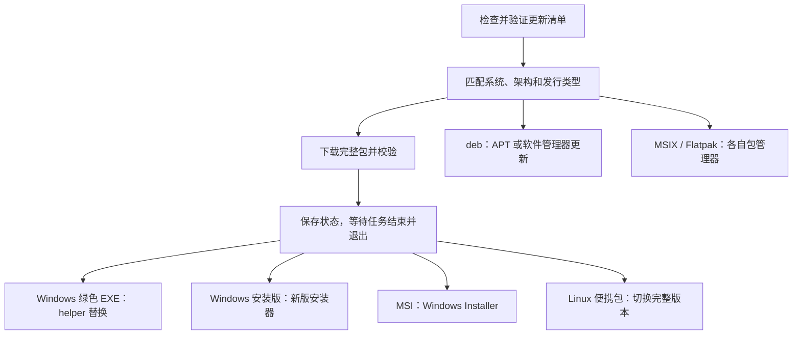

# PySide6 桌面版的发行、安装与升级调研

> 历史设计/评审：保留当版基线、建议和决策。当前行为见 [使用文档](README.md#当前使用与开发)，未完成功能见 [backlog.md](backlog.md)，缺陷与流程问题见 [workflow-issues.md](workflow-issues.md)。构建、测试与发布从 [handoff.md](handoff.md) 进入，不直接执行下方旧版命令。

2026-10-11 补充：维护者已确认更新功能方案并批准代码实施，见[《更新方案》](application-update-plan.md)与[开发指南](application-update-development.md)。新方案采用固定域名 `https://bilix.djhx.site`，应用直接下载改为 GitHub 优先、自有服务器备用，并细化渠道元数据、签名、Windows 两种包和 APT 源。本文保留历史调研，其中“服务器主源、GitHub 镜像”的建议不再作为新更新功能的源优先级；历史“尚未实现”的描述不代表当前开发状态。

调研日期：2026-10-03。范围：Windows、Ubuntu/Debian；macOS 留待后续。本文保留方案形成时的调研与后续升级建议。源码实现和实际验证状态以 [GUI 构建与发行](gui-build-and-release.md) 为准；调研中的“建议”不代表已有产物或已完成安装、升级实测。

1.6.0 已交付绿色 EXE、Inno Setup 和 deb，采用手动升级；没有应用内检查/下载更新、MSI、APT 源或自动替换 helper。Inno 模板目前没有显式比较已安装版本的降级保护。实际完成情况见[首版复核](validation-1.6.0.md)，升级/更新优先级见[版本建议](roadmap.md)，新实现须按[测试规范](testing.md)补验。本文记录当时的工具/平台资料，依赖升级前重新核对官方来源。

## 调研结论

PySide6 可以提供 Windows 单文件绿色 EXE，也可以提供 EXE 安装器、MSI 或 MSIX。GUI 框架、应用打包工具、安装器和更新源承担不同职责：

- **PySide6/Qt**：界面和平台集成。
- **Nuitka / pyside6-deploy**：把应用、Python、Qt 和原生依赖组成可分发程序。
- **Inno Setup / WiX / Qt Installer Framework 等**：安装、卸载、快捷方式和已安装版本升级。
- **公网服务器 / GitHub Releases**：存储更新清单与产物；客户端或包管理器负责应用更新。

Qt 官方 `pyside6-deploy` 基于 Nuitka，明确支持 `onefile` 和 `standalone`；它不会自动替项目完成所有安装器和更新逻辑。[Qt 部署工具](https://doc.qt.io/qtforpython-6/deployment/deployment-pyside6-deploy.html)

结合 BiliX 的规模，建议的首版发行组合是：

| 使用场景 | 建议形式 | 更新方式 |
| --- | --- | --- |
| Windows 绿色版 | Nuitka onefile，单个 EXE | 检查与下载更新；退出后替换，保留手动下载入口 |
| Windows 常规安装 | Nuitka standalone + Inno Setup EXE | 下载新版安装器，在任务结束并退出后升级 |
| Windows 统一部署 | WiX MSI，需求明确后增加 | Windows Installer 管理完整包升级、修复与卸载 |
| Ubuntu/Debian 安装版 | 包含私有运行时的 `.deb` | 自建签名 APT 源；也可下载安装新 `.deb` |
| Linux 便携版 | standalone 的 `.tar.gz`；单文件形式可选 | 用户目录中切换完整版本；AppImage 或 Nuitka onefile 按验证结果增加 |

这些形式共用一份业务源码。更新入口识别发行类型，只执行对应方式，避免安装器管理的文件被应用直接覆盖。

## Windows 支持与依赖

当前建议基线为 CPython 3.14.8、PySide6/Qt 6.11.2、Nuitka 4.2.2。PySide6 官方发行提供 Windows x64 和 ARM64 wheel，要求 Python `>=3.10,<3.15`；这里的架构支持还需要与 BiliX 的 curl-cffi、FFmpeg 和编译工具逐一匹配。[PySide6 元数据与发行文件](https://pypi.org/project/PySide6/6.11.2/)

| Windows 范围 | 官方基础 | BiliX 建议 |
| --- | --- | --- |
| Windows 10 x64 | Qt 6.11 列出 1809+；Python 3.14 支持 Windows 10+ | 本轮在 22H2 虚拟机验证；框架最低版本不等于应用支持承诺 |
| Windows 11 x64 | Qt 6.11 支持；Python 3.14 支持 | 本轮暂缓，后续再做安装与升级验收 |
| Windows ARM64 | Qt 与 PySide6 有对应构建 | 后续增加原生包；当前 x64 FFmpeg 不能直接作为原生 ARM64 依赖 |
| Windows 7/8.1、32 位 Windows | 当前技术基线不覆盖 | 首版不列入支持矩阵 |

来源：[Qt 6.11 支持平台](https://doc.qt.io/qt-6.11/supported-platforms.html)、[Python 3.14 Windows 支持](https://docs.python.org/3.14/using/windows.html#supported-windows-versions)。

Qt 6.11 文档还注明 Qt 6.12 将是最后支持 Windows 10 的版本。因此，如果决定长期支持 Windows 10，未来“跟进最新 Qt”需要同时检查最低系统要求，并对不兼容的新版本停止推送。[Qt 平台说明](https://doc.qt.io/qt-6.11/supported-platforms.html)

### 目标机器无需安装 Python/Qt

独立发行应包含 Python 运行时、PySide6/Qt DLL、所需 Qt 插件、curl-cffi 原生库、FFmpeg、图标和翻译资源。Windows 至少要正确收集 `platforms/qwindows.dll`，并根据实际构建处理 Microsoft C/C++ 运行库。绿色版需要验证 app-local 依赖收集，安装器可处理需要安装的运行库；以干净系统结果判断，不依赖开发机已安装的组件。[Qt Windows 部署](https://doc.qt.io/qt-6.11/windows-deployment.html)

PySide6/Nuitka 使用自身插件收集机制。`windeployqt` 的原生 Qt 部署文档可用于核对 DLL/插件边界，但不应直接从另一套 Qt SDK 复制同名 DLL 到 PySide6 包中。第三方 Qt 程序设置的 `QT_PLUGIN_PATH`、用户 PATH 和不同 Qt 版本也要纳入冲突测试。

GUI 构建关闭控制台窗口，并保留脱敏的文件诊断；FFmpeg 等子进程继续隐藏控制台。图形程序仍以普通用户运行，安装阶段所需的管理员权限不传递给日常下载流程。

## Windows 单文件绿色 EXE

**可以实现单个大 EXE 直接分发，包含 FFmpeg。** Nuitka onefile 先组合独立应用，再把内部文件嵌入外壳，启动时释放到临时目录或指定缓存目录运行。[Nuitka onefile 说明](https://nuitka.net/user-documentation/use-cases.html)

| 项目 | 实际行为与设计要求 |
| --- | --- |
| 外部分发 | 可以只有一个 `BiliX-Portable.exe`；无需安装和管理员权限 |
| 内部运行 | Qt DLL、插件及 FFmpeg 仍会释放为文件；这不是 Qt 静态链接方案 |
| 首次启动 | 包越大，解压与磁盘写入可能越明显；需测量实际耗时 |
| 后续启动 | 可测试带版本的缓存路径，评估复用收益；不能让不同版本覆盖同一运行目录 |
| 临时空间 | 需要可写位置以及解包空间；不可执行或只读目录应有清楚提示 |
| 多实例 | 解包路径与缓存清理必须避免冲突，更新时协调同一副本的所有实例 |
| 升级 | 完整下载新 EXE 后，等待旧版本全部退出再替换 |
| 卸载 | 用户删除 EXE 即移除程序主体；配置、缓存和下载文件按各自规则处理 |

单文件分发不等于运行时没有临时文件，也不等于配置必须放在 EXE 旁边。建议默认仍使用当前 `platformdirs` 业务目录，使绿色版与安装版共用账号和设置；如果以后增加“所有数据随 U 盘移动”的模式，应显式启用，并检查所在目录权限。

Nuitka 文档提供带公司、产品与版本的解包缓存模板。可以基于版本固定缓存，但需验证并发启动、升级后清理和错误中断，不承诺缓存一定改善所有启动场景。[Nuitka 解包路径](https://nuitka.net/user-documentation/use-cases.html)

### 单文件 EXE 的更新流程

建议先实现“发现更新 → 用户选择下载 → 校验 → 当前任务结束后更新”。下载到独立 staging 目录，并使用 `.part` 文件；未下载完成的文件不能被执行或替换当前版本。

Windows 会锁住运行中的程序。替换需要独立 helper，或让用户手动关闭程序后运行新版本。onefile 常有外壳与 GUI 子进程，因此 helper 必须等待外壳、GUI、关联 FFmpeg 与该副本的其他实例全部结束；只等待 GUI 的 PID 可能还不能替换外部 EXE。[Nuitka 文件锁说明](https://nuitka.net/user-documentation/use-cases.html)

helper 要先放到不会被 onefile 退出清理的独立目录。新 EXE 先完整校验，再在目标同一文件系统内准备替换，保留旧版本；处理占用、权限、磁盘不足与操作中断。绿色版位于不可写位置时，回退到下载并提示手动替换。

发布时，单文件版本至少要检查冷启动与重复启动、外壳退出，以及未来引入自更新后的完整生命周期。1.6.0 的 Qt GUI 绿色版已经执行中文路径下的两次启动自检与真实桌面检查，具体记录见 [Windows 10 验收](gui-win10-validation.md)；自动更新尚未实现，更新生命周期留待引入该功能时验证。

## Windows EXE 安装版

建议使用 **Inno Setup 7.1.0**，当前正式稳定发行。应用内容采用 Nuitka standalone 目录；Setup 本身是一个可下载的 EXE，安装后程序按普通目录布局运行，无需每次解包 Qt。[Inno Setup 7.1.0](https://github.com/jrsoftware/issrc/releases/tag/is-7_1_0)

这一路线适合安装目录选择、开始菜单、桌面快捷方式、系统“已安装应用”记录、卸载和后续完整包升级。用户看到的是安装器，内部仍是独立打包的 Python/Qt 程序。

### 安装权限与目录

首版建议采用当前用户安装，程序位于 `%LOCALAPPDATA%/Programs/BiliX`，设置 `PrivilegesRequired=lowest`，无需日常申请 UAC。机器级安装可另行增加，安装到 Program Files 并在安装/升级阶段申请权限。[Inno 安装权限](https://jrsoftware.org/ishelp/topic_setup_privilegesrequired.htm)

业务配置仍调用现有 `load_settings()`，使用 `platformdirs` 和 `BILIX_CONFIG_DIR` 规则。当前用户安装目录、凭据目录和更新缓存目录分别管理；配置目录不包含产品版本号。应用不向安装目录写下载结果或账号数据。

### 升级识别与程序退出

整个稳定版本系列保持固定 `AppId`，更新时复用已安装位置和卸载记录。安装范围、架构、版本及发行类型记录在安装元数据中；稳定版和测试版并存时明确使用独立身份。[Inno AppId](https://jrsoftware.org/ishelp/topic_setup_appid.htm)

GUI 的更新流程只下载并启动新版安装器，由安装器管理文件和卸载记录。版本切换时要处理新包不再包含的旧文件，但只删除明确属于应用的旧文件，不能通配清除下载目录或共享用户配置。

Inno 的 `CloseApplications` 使用 Windows Restart Manager，静默模式可能关闭占用文件的程序。因此 BiliX 必须在运行安装器前保存队列、停止或完成任务、退出 FFmpeg；不要依赖安装器强制杀掉正在写媒体文件的应用。[Inno CloseApplications](https://jrsoftware.org/ishelp/topic_setup_closeapplications.htm)

安装器返回值、重启需求和失败恢复需要实测。不能仅凭使用了 Inno 就承诺任意失败都完整回滚，尤其是用户配置格式的迁移。卸载默认保留下载文件和共享账号/设置，删除用户数据另作明确选择。

## MSI 与 MSIX

### MSI：可以提供，适合统一部署

MSI 是 Windows Installer 软件包，PySide6 应用可以使用 WiX 封装。当前 WiX 正式稳定版为 **7.0.0**；新方案不沿用 snake 的 WiX 3.x 脚本。[WiX 7.0.0](https://github.com/wixtoolset/wix/releases/tag/v7.0.0)

| 对比 | Inno EXE 安装器 | WiX MSI |
| --- | --- | --- |
| 常规安装/卸载 | 支持 | 支持 |
| 无界面安装 | 支持参数控制 | 支持 `msiexec`，适合统一部署 |
| Windows Installer 修复与管理 | 不使用 MSI 数据库 | 原生 MSI 能力 |
| 构建维护 | `.iss` 脚本管理应用目录 | 需管理安装身份、组件、版本、升级规则与安装上下文 |
| BiliX 首版选择 | 推荐 | 有企业部署、修复或明确 MSI 需求时增加 |

MSI 建议安装 standalone 内容，完整新包采用 major upgrade 策略：保持 UpgradeCode，按升级规则更换 ProductCode 和包身份，阻止意外降级。MSI 的 major upgrade 是安装技术术语，不要求业务版本必须从 1.x 升到 2.x。[Windows Installer major upgrade](https://learn.microsoft.com/en-us/windows/win32/msi/major-upgrades)

MSI 只按前三个 ProductVersion 字段比较，范围为 `255.255.65535`，忽略第四字段；预发布版本不能直接塞入数字版本字段，需要制定与项目版本的映射。每用户和每机器安装不能通过 major upgrade 自动跨上下文迁移。[ProductVersion](https://learn.microsoft.com/en-us/windows/win32/msi/productversion)、[安装上下文要求](https://learn.microsoft.com/en-us/windows/win32/msi/major-upgrades)

以后同时提供 Inno 与 MSI 时，两者不是相互识别的同一个安装数据库。首版应阻止同一目标路径的交叉覆盖；改换安装渠道走明确迁移流程，保留共享用户数据。MSI 安装的文件始终交给 MSI 更新，不使用绿色版 helper 直接修改。

WiX 6 起引入 Open Source Maintenance Fee，WiX 7 增加 EULA 接受机制。官方要求符合其年收入条件的组织承担维护费；是否适用需要按实际使用主体核对，不能沿用“新版 WiX 无任何额外使用条件”的假设。[WiX OSMF 条款](https://docs.firegiant.com/wix/osmf/)

### MSIX：不同于 MSI，可利用系统更新

MSIX 可以封装传统 Win32 桌面程序，并通过 `.appinstaller` 从自建 HTTPS 地址安装和检查更新，不要求一定进入 Microsoft Store。指定更新检查、提示和备用 URI 后，可由 Windows App Installer 管理应用更新。[MSIX 自动更新](https://learn.microsoft.com/en-us/windows/msix/app-installer/auto-update-and-repair--overview)

这条路线需要受信任的包签名和稳定的包身份；安装内容为只读，应用不能直接覆盖安装目录。不同 Win32 打包类型具有不同的 AppData/注册表虚拟化行为，需核对 CLI/GUI 凭据共享、卸载数据、下载目录和 FFmpeg 子进程，而不是笼统把全部 MSIX 应用视为 UWP 沙箱。[打包桌面程序的运行行为](https://learn.microsoft.com/en-us/windows/msix/desktop/desktop-to-uwp-behind-the-scenes)、[桌面应用打包准备](https://learn.microsoft.com/en-us/windows/msix/desktop/desktop-to-uwp-prepare)

如果以后明确需要 Store 或 Windows 原生包自动更新，可以增加 MSIX。当前希望同时提供绿色 EXE，并优先使用简单的现有 Python 打包路线，Inno 更容易作为首个安装渠道。

## Windows 签名与公开下载体验

公网服务器和 GitHub 都能分发 EXE/MSI，下载源本身不会免除 Windows 的发布者校验。公开发行建议对主程序、安装器和自有更新 helper 做 Authenticode 签名与时间戳；签完文件再计算公开 SHA256。[SignTool](https://learn.microsoft.com/en-us/windows/win32/seccrypto/signtool)

签名能显示经过验证的发布者，但新文件仍可能遇到 SmartScreen；微软已明确 EV 证书不再自动获得即时免提示待遇。不要把购买 EV 当成必然消除提示的办法。[微软 SmartScreen 说明](https://learn.microsoft.com/en-us/windows/apps/package-and-deploy/smartscreen-reputation)

Windows 代码签名证书与更新清单签名密钥用途不同：前者用于系统识别发布者，后者用于应用校验候选更新。发布私钥、证书密码和服务器写权限不放进源码、安装包或更新服务器公开目录。

## Ubuntu/Debian 的运行兼容性

应把操作系统版本、CPU 架构、glibc 和图形会话一起列入支持矩阵。下表中的可行性来自发行文件与系统基础库的交集，仍需运行完整 BiliX GUI 验证。

| 平台 | 当前 PySide6 6.11.2 预编译 x64 基线 | 建议 |
| --- | --- | --- |
| Ubuntu 22.04 LTS x64 | glibc 2.35 高于 wheel 要求 2.34 | 纳入较老系统验证；可作为 Linux 构建环境候选 |
| Ubuntu 24.04 LTS x64 | 符合 glibc 要求 | 主要目标 |
| Ubuntu 26.04 LTS x64 | 当前正式 LTS；需验证新桌面与依赖变化 | 主要目标；GNOME 默认 Wayland 路径必须检查 |
| Debian 12 x64 | glibc 2.36 高于 2.34 | 纳入验证 |
| Debian 13 x64 | glibc 2.41 高于 2.34；当前稳定系列 | 纳入验证 |
| Ubuntu 20.04 / Debian 11 x64 | glibc 低于当前 wheel 基线 | 不纳入默认预编译包；需要另选基线或重建依赖 |
| Linux ARM64 | 当前 wheel 要求 glibc 2.39+ | 后续使用独立构建与验证，不能套用 x64 最低环境 |

来源：[PySide6 wheel 标签](https://pypi.org/project/PySide6/6.11.2/)、[Ubuntu 22.04 libc6](https://packages.ubuntu.com/jammy/libc6)、[Debian 12 libc6](https://packages.debian.org/bookworm/libc6)、[Debian 13 版本信息](https://www.debian.org/releases/trixie/release-notes/whats-new.en.html)、[Ubuntu 26.04 发行](https://documentation.ubuntu.com/release-notes/26.04/)。

Qt 源码支持的平台范围与 PySide6 预编译 wheel 的范围不同。例如 Qt 6.11 平台页列有 Debian 11，但当前 PySide6 x64 wheel 仍有 glibc 2.34 下限，不能据前者承诺直接安装后者。[Qt 支持平台](https://doc.qt.io/qt-6.11/supported-platforms.html)

### 构建基线和系统库

建议从 Ubuntu 22.04 x64 与 Debian 12 x64 候选环境验证构建，选择能覆盖计划最低运行系统的环境。应用主程序、Qt、curl-cffi 和 FFmpeg 的最终 ELF 依赖共同决定下限；在 Ubuntu 26.04 构建后压成包，不会自动得到 Ubuntu 22.04 兼容性。

glibc 不能按普通应用 DLL 的思路随意替换系统版本。AppImage、onefile 或 `.deb` 都不会消除已编译二进制的符号要求；还要检查 GLIBCXX、OpenSSL 及实际图形依赖。

对于 `.deb`，先验证是否可共用应用 payload，再按各发行版生成与核验依赖。Ubuntu/Debian 即使都用 deb，也可能有不同的系统库包名和版本，不能只在一个系统生成 Depends 后承诺全部可用。使用 `dpkg-shlibdeps` 等工具辅助扫描，Qt 运行时才加载的插件另行检查。[Debian 共享库依赖工具](https://manpages.debian.org/bookworm/dpkg-dev/dpkg-shlibdeps.1.en.html)

### X11、Wayland、字体与输入法

Qt 支持通过 xcb 平台插件运行于 X11，也支持 Wayland QPA 插件。预编译包需收集所需插件及其运行库，尤其是 xcb-cursor、xkbcommon、字体和输入法相关依赖；不能把“找到了插件文件”视为它的动态依赖也已齐全。[Qt Linux 依赖](https://doc.qt.io/qt-6.11/linux-requirements.html)、[Qt Wayland](https://doc.qt.io/qt-6.11/wayland-and-qt.html)

Ubuntu 26.04 的默认 GNOME 桌面会话使用 Wayland，X11 应用仍可通过 XWayland 运行。因此需要测试原生 Wayland 和实际 XWayland 回退，同时测试其他桌面的 X11。首版不依赖全局窗口坐标或复杂窗口效果。[Ubuntu 桌面变化](https://documentation.ubuntu.com/release-notes/26.04/summary-for-lts-users/)

中文标题、IME、复制粘贴、文件选择、打开结果目录、缩放、系统主题与证书/代理都应在目标桌面测试。Qt 自带控件翻译需显式保留所需语言；官方 deploy 默认参数可能排除 Qt translations，不能因此让标准对话框全部显示英文。

## Linux 安装与升级形式

| 形式 | 安装体验 | 更新责任 | 对 BiliX 的判断 |
| --- | --- | --- | --- |
| `.deb` + 签名 APT 源 | 系统级安装，菜单和卸载记录完整 | APT、系统软件管理器 | Ubuntu/Debian 首选 |
| 单独 `.deb` 下载 | 可以用 APT 安装本地包并解决依赖 | 手动安装新版；加源后才能从该源更新 | 可作为最初交付和备用 |
| `.tar.gz` standalone | 解压后普通用户运行；桌面集成需处理 | 手动替换或便携 updater | 稳妥的便携备用形式 |
| Nuitka onefile ELF | 单文件，设置执行权限后运行；启动解包 | 退出后替换，应用负责 | 需要单文件时可验证；不需要 AppImage 的 FUSE 挂载机制 |
| AppImage | 单文件，可携带应用运行库；运行时要求取决于所用 runtime | 手动换包或 AppImage 更新机制 | 可选；验证 FUSE、桌面集成和 ABI |
| Flatpak | runtime 与应用分离，系统软件中心可管理 | Flatpak remote | 后续跨发行版渠道；需处理文件和凭据边界 |
| Qt Installer Framework `.run` | 自有安装器、维护工具与网络仓库 | Qt maintenance tool | 若希望统一自有安装体验可考虑，不能代替 APT 包记录 |

### `.deb` 与自建 APT 源

当前 `.deb` 方案包含私有 Python/Qt/原生依赖，并将发行版 `ffmpeg` 声明为系统依赖；用户无需安装 Python 或 PySide6。系统图形基础库也应列入实际 ELF 扫描得出的 Depends。应用安装目录与用户配置分离，保留桌面文件、图标和普通用户启动入口。

本地文件可使用 `sudo apt install ./包名.deb` 安装和更新，APT 能处理已声明且可获得的依赖。`dpkg -i` 本身不负责下载依赖。1.6.0 的实际 `.deb` 构建与目标系统检查记录见 [Linux VM 矩阵](gui-vm-validation.md)。[Ubuntu 软件包管理](https://ubuntu.com/server/docs/tutorial/managing-software/)

**把 `.deb` 上传到公网服务器或 GitHub，并不会自动获得 APT 更新。** 自建源需要 Packages 索引、Release/InRelease、包哈希和仓库签名，以及客户端源与密钥配置。推荐 Deb822 `.sources` 和单独 `Signed-By` 密钥；以仓库签名和索引哈希建立包真实性验证。[apt-secure](https://manpages.debian.org/trixie/apt/apt-secure.8.en.html)、[sources.list](https://manpages.debian.org/trixie/apt/sources.list.5.en.html)

静态 HTTPS 服务器即可承载签好的 APT 仓库，不需要为每次请求运行后台业务服务。按发行版代号分发依赖信息，仓库密钥在首次配置时通过可信发布渠道提供；私钥保留在发布环境。

加入源后，用户通过 APT 或系统软件管理器升级；应用内可提示版本和操作入口，不以 root 运行 GUI，不自行改写 `/usr` 下由 dpkg 管理的文件。是否启用无人值守更新取决于系统的来源策略，不是添加源后必然自动更新。

### AppImage 与单文件 ELF

Nuitka onefile 是自解包程序；AppImage 是另一套应用镜像格式，可以封装 standalone 应用。不要在 AppImage 内再嵌套 Nuitka onefile，避免重复封装与解包。

AppImage 的运行时需求取决于采用的 runtime。传统 type 2/FUSE 2 方案可能需要 `libfuse2`，Ubuntu 24.04 对应包名为 `libfuse2t64`；官方提供 extract-and-run 回退。Ubuntu/Debian 的干净安装环境需要实际检验，不承诺任意 AppImage 都无需额外库。[AppImage FUSE 说明](https://docs.appimage.org/user-guide/troubleshooting/fuse.html)

AppImage 可以嵌入更新信息并使用 `.zsync`/AppImageUpdate 从 HTTP 或 GitHub 获取更新，但不会只因扩展名是 AppImage 就自动具备更新功能。需要准备元数据和客户端集成；真实性验证仍要明确。首版整包下载更容易与 Windows 采用一致的发布流程。[AppImage 更新文档](https://docs.appimage.org/packaging-guide/optional/updates.html)

### Flatpak 的额外适配

Flatpak 默认限制主机文件和网络访问，并使用应用私有数据位置。BiliX 需要网络权限、下载目录访问与必要桌面 portal；外部保存路径和当前 CLI 凭据目录不一定直接可见。若后续增加 Flatpak，应设计凭据共享或导入方式，并把 FFmpeg 包含在正确的运行环境中。[Flatpak 权限](https://docs.flatpak.org/en/latest/sandbox-permissions.html)

这些差异不妨碍使用 PySide6，但会增加首版平台验证。当前目标明确为 Ubuntu/Debian，因此先完成 deb/APT 与一个便携形式更集中。

## Qt Installer Framework 能否统一安装升级

**可以作为独立方案。** 当前稳定基线为 Qt Installer Framework **4.11.0**，提供跨平台离线/在线安装器、maintenance tool、组件安装/卸载与网络仓库更新。网络仓库可以部署在自己的服务器。[Qt IFW 4.11.0 公告](https://www.qt.io/blog/qt-online-installer-and-qt-installer-framework-4.11.0-released)、[功能概述](https://doc.qt.io/qtinstallerframework/ifw-overview.html)

它与 PySide6 的业务代码版本独立，能够安装 Nuitka 打包的应用；但不是 `pyside6-deploy` 自带的应用自动更新能力。需要维护组件描述、配置、脚本、Updates.xml 仓库，以及 maintenance tool 自身的更新。[在线仓库](https://doc.qt.io/qtinstallerframework/ifw-online-installers.html)、[维护工具更新](https://doc.qt.io/qtinstallerframework/ifw-updates.html)

从 IFW 4.10 起，Qt 不再提供独立的预编译 IFW 安装包；可从 Qt Online Installer 的 Build tools 获取，或从源码构建。[官方发行说明](https://www.qt.io/blog/qt-online-installer-and-qt-installer-framework-4.11.0-released)

如果以后要让 Windows/Linux 都使用同样的自有安装与组件更新体验，IFW 值得重新比较。对于当前只有一个下载工具和 FFmpeg 的整体包，Inno + deb/APT 更贴近两个平台的习惯；绿色版也仍需要独立的更新策略。

## 自建服务器与 GitHub 的升级架构

### 建议服务器主源、GitHub 镜像

应用读取有签名的版本清单，根据平台、架构、操作系统要求、发行类型和渠道选择产物。清单在自己的 HTTPS 服务器提供，GitHub Releases 存放同一版本的完整包、清单和签名。服务器与 GitHub 是下载位置，安装逻辑由发行类型决定。

这种安排可以使用自有下载速度和域名，也保留公开发行页与备用源。不要求客户端登录，不在 GUI 内嵌 GitHub Token，不把 Bilibili Cookie 发送给更新源。

GitHub 公共 REST API 未认证请求通常按来源 IP 每小时 60 次限额。大量用户共享 IP、频繁启动查询会受到影响；版本查询使用缓存、有限频率和退避，普通更新不必每次依赖 GitHub API。[GitHub API 限额](https://docs.github.com/en/rest/using-the-rest-api/rate-limits-for-the-rest-api)

### 最小清单字段

| 数据 | 作用 |
| --- | --- |
| schema、产品 ID、版本、发布序号、渠道 | 正确解析、版本比较、稳定/测试版区分及防止无意降级 |
| 发布时间、有效期、签名 key ID | 检查清单新鲜度和验证密钥 |
| platform、arch、package_type、安装范围 | 避免向 deb/MSI/绿色版推送错误包 |
| 最低 Windows build / glibc 或 distro 约束 | 不向当前系统推送无法运行的框架升级 |
| 产物 size、SHA256、候选 HTTPS URL | 下载完整性、空间预估与主源/镜像选择 |
| 内核版本、配置格式兼容范围、发行说明 | 评估客户端数据迁移与用户理解更新内容 |

清单签名覆盖元数据和产物哈希；客户端使用内置受信公钥验证后才选择与下载候选。按实际版本语义比较，不能字符串比较 `1.10` 与 `1.9`。稳定渠道不误选 prerelease；镜像回退只能使用同一受验证清单中的产物，不能回退到未签名数据。

SHA256 能发现损坏，但若清单和包一起被替换，只有哈希不足以确认发布者。建议使用成熟签名实现；密钥轮换、清单过期和防回放可参考 TUF，需要更完整机制时直接评估 TUF，而不是自己实现密码算法。[TUF 更新验证模型](https://theupdateframework.io/docs/overview/)

### 按安装形式应用更新



图中“匹配更新清单”是 BiliX 的提示与分流设计；APT、MSIX 和 Flatpak 的仓库校验、下载与安装仍由其管理系统执行，不能以应用校验替代包管理器验证。

首版建议以完整包更新为主，先实现可见的“检查更新、下载、任务结束后安装”。静默无人值守和差量更新可以在稳定流程之上增加，不影响用户手动获取发行文件。初次离线安装包也应提供，更新源不可用时仍能运行已有版本。

### 服务器目录与发布顺序

服务器可以分别提供版本化文件、stable/beta 清单及 APT 目录。例如下面仅表示拟议结构，不表示已经建立这些地址：

```text
/bilix/releases/<version>/windows-x64/...
/bilix/releases/<version>/linux-x64/...
/bilix/updates/stable/manifest.json
/bilix/updates/stable/manifest.sig
/bilix/apt/dists/<suite>/...
/bilix/apt/pool/...
```

版本化产物发布后不覆盖同一 URL 的字节；产物可长缓存，当前渠道清单采用短缓存/条件请求。先上传并验证全部候选产物及签名，再切换当前清单。APT 的包、索引与 Release/InRelease 同样保持哈希一致，发布切换期间考虑旧缓存需要的文件保留。

需要验证 HTTPS 证书、重定向、代理、超时、范围下载与下载中断。公网服务器应正确支持文件长度及普通静态文件响应；将来要用差量或恢复下载再要求对应 Range 行为。服务器不需要接收账号凭据或执行客户端安装命令。

### 数据迁移与恢复

更新把程序、Qt、Python 和 FFmpeg 作为经过验证的完整版本切换，避免用户运行时自行 pip 更新其中一个依赖。业务配置和凭据沿用共享位置；GUI 专属状态独立存放，必要迁移先备份并原子写入。

便携更新可保留上一个程序版本并在新版本启动失败时提供恢复；安装版使用其安装器支持的恢复方式及旧包。若新版本已经改变配置或任务数据库，程序回退不等于数据回退，需要兼容性或备份，不能只保留旧 EXE 就承诺完整回滚。

## 编码前的验证清单

| 领域 | 必须覆盖的实际场景 |
| --- | --- |
| Windows 冷环境 | 无 Python/Qt/开发工具，标准用户运行；所需运行库齐全 |
| Windows 安装范围 | 当前用户与机器级权限、开始菜单、卸载、旧版本识别、降级阻止 |
| onefile | 中文路径、冷启动/缓存启动、多实例、解包空间不足、外壳退出及 helper 存活 |
| 更新事务 | 清单签名错误、包哈希错误、源离线、断网、磁盘不足、文件被占用、用户取消、恢复旧版本 |
| 业务事务 | 下载/校验/合并/提交阶段遇到更新，队列保存，FFmpeg 无残留，原输出文件完整 |
| Ubuntu/Debian | 建议矩阵中的桌面 VM，glibc/GLIBCXX、所有平台插件和 curl/FFmpeg 依赖 |
| Linux 安装管理 | deb 本地安装/升级/卸载、APT 源签名与密钥、不同发行版包名、GUI 普通用户运行 |
| 桌面体验 | Wayland、X11/XWayland、IME、中文字体、125%/150%/200% 缩放和文件对话框 |
| 渠道切换 | 绿色与安装版共享数据；Inno/MSI 交叉安装不覆盖；未来沙箱渠道的数据迁移 |

此表保留后续正式发行与自动升级所需的完整验证范围。1.6.0 的 Windows 绿色版、Inno 安装版与 Linux `.deb` 已有构建流程；各系统的实际验收结论见 [GUI 构建与发行](gui-build-and-release.md)、[Windows 10 VM 记录](gui-win10-validation.md)与 [Linux VM 矩阵](gui-vm-validation.md)。自动更新尚未实现。
