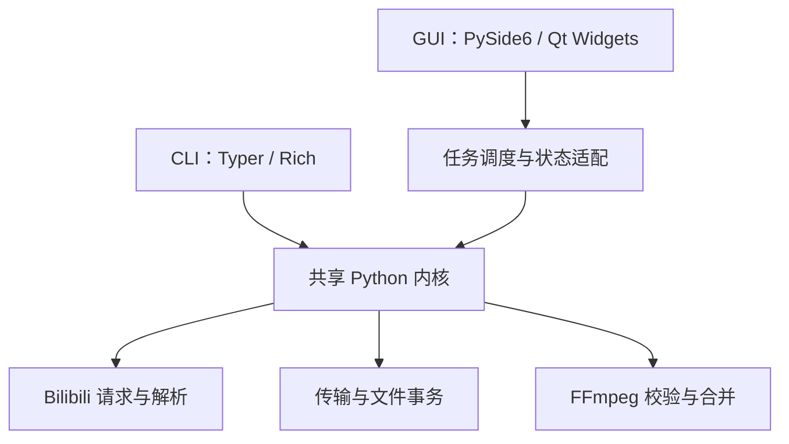

# GUI 技术选型评估

评估日期：2026-10-03。依据：当时的 BiliX 1.5.0 源码、同级目录中的 snake 项目，以及当时查询的官方发行信息和文档。本文是历史选型记录，所列工具版本不代表后续始终为最新版。

状态：选型决策记录。PySide6/Qt Widgets 方案已进入源码实现；文中的部分接口和发行流程保留原先的设计建议，实际用法以 [GUI 使用说明](gui-usage.md) 和 [GUI 构建与发行](gui-build-and-release.md) 为准。版本兼容性仍需以各平台实际构建验证。

首版平台确定为 Windows 10 x64、Ubuntu 22.04/24.04 与 Debian 12/13 amd64；macOS、Windows 11 与 ARM 后续评估。本文保留技术选型阶段的比较，实际验收以各平台测试记录为准。

## 推荐方案

推荐 **Python + PySide6 + Qt Widgets**，直接复用现有 Python 下载内核，CLI 与 GUI 在同一个 Git 仓库内维护，分别提供入口和发行文件。

Java + JavaFX 可以实现这款工具，界面能力足够，也有 snake-game 的实践可以参考。对于当前 BiliX，选择 PySide6 的主要理由是已有业务实现、依赖和构建流程都以 Python 为中心。它可以减少跨语言通信、双运行时打包及同步维护的工作。

如果后续明确要以 Java 作为桌面开发主语言，JavaFX 是合理的备选。建议采用 JavaFX 界面调用独立 Python worker 的结构，继续共用下载内核。全面重写为 Java 则应作为另外一项业务迁移评估。

## 现有项目提供了哪些基础

### BiliX

目前已经具备可复用的模块边界，详见 [架构说明](architecture.md)：

| 模块 | GUI 可以如何使用 | 需要补充的内容 |
| --- | --- | --- |
| `bilibili/client.py`、`parser.py` | URL 解析、视频与选集信息、账号可获取的播放流 | 适配任务取消及安全的错误事件 |
| `models.py`、`planner.py` | 选集、清晰度、编码、音轨与输出计划 | 为界面提供稳定的数据快照 |
| `downloader.py` | 重试、备用 CDN、字节校验和下载进度回调 | 协作取消；进度汇总 |
| `media.py`、`service.py` | 媒体校验、合并及原子提交 | 阶段事件；可控的 FFmpeg 子进程生命周期 |
| `auth.py`、`credentials.py`、`config.py` | 扫码登录、凭据与共享业务配置 | 结构化登录事件、取消登录、配置写入接口 |
| `cli.py`、`presentation.py` | 保留终端交互 | GUI 使用自己的展示层 |

选型时下载器已经提供字节进度，但执行过程是同步编排，FFmpeg 通过阻塞的子进程调用运行，登录通过字符串通知和轮询实现。当时尚无 GUI 任务队列、取消协议或暂停/断点续传功能。

1.6.0 已实现窗口内串行队列、后台 QThread、结构化阶段/登录事件与协作取消；未实现持久历史、暂停/续传或应用内更新。不要把下文建议当作已实现接口。现状见[架构](architecture.md)、[首版复核](validation-1.6.0.md)，后续建议见[版本规划](roadmap.md)，验证以[持续测试规范](testing.md)为准。

网络层使用 curl-cffi 的浏览器请求模拟。改用 Java HTTP 客户端需要重新验证请求行为、账号权限和接口适配，不能按界面迁移自动视为等价替换。

### snake 项目

实际桌面参考应以同级 `snake-game` 为主：旧 `snake-client` 的 README 已注明迁移；`snake-game-web` 和 `snake-game-web-client` 属于网站/Web 客户端。

| 观察 | 对 BiliX 的启示 |
| --- | --- |
| Maven 多模块包含 shared/server/client；使用 JDK 21、JavaFX 21.0.6 | JavaFX 已有项目实践，但新工具不需要复制游戏服务端与网络结构 |
| 界面由 Java 控件和 CSS 组织 | 简单桌面工具可以沿用这种组织方式，FXML 是可选项 |
| JavaFX Maven 插件、jlink、jpackage 构建 | 可以参考运行时裁剪、便携包、安装包及版本元数据的流程 |
| 网络事件调度合并最新状态再刷新界面 | 下载进度也需要合并高频更新，避免界面事件积压 |
| Windows 和 Debian 打包脚本 | 可以参考平台目录、图标和桌面入口处理，但需重新适配工具版本 |
| Maven Wrapper 固定 3.8.5；Windows 脚本按 WiX 3.x 编写 | 新项目应重新选择版本，不能直接沿用旧环境假设 |

BiliX 的表单、列表和对话框比游戏画布与实时对战交互简单。GUI 版本仍需要处理任务取消、文件事务和不同系统的独立发行，这些工作需要单独验证。现有 snake 脚本也不足以证明 macOS 安装包已经得到验证。

## PySide6 与 JavaFX 的差异

以下评价结合 BiliX 的现有代码；开发与维护成本属于工程判断。

| 维度 | PySide6 + Qt Widgets | Java + JavaFX |
| --- | --- | --- |
| 业务复用 | 后台线程直接调用 Python 内核 | 保留 Python 内核时，需要进程通信；纯 Java 方案需要业务重写 |
| 开发语言 | Python；可用类型标注和数据类约束接口 | Java 强类型；界面开发与内核使用两种语言 |
| 界面能力 | 表单、表格、菜单、对话框、进度条足够；少量 QSS 定制 | Controls、布局和 CSS 同样足够；可参考 snake 项目 |
| 后台任务 | QObject worker/QThread，信号回传主线程 | Java 后台任务与 FX 线程调度，加 Python worker 生命周期管理 |
| 打包内容 | Python、Qt、现有原生依赖及 FFmpeg | Java/JavaFX 运行时，以及 Python worker、原生依赖和 FFmpeg |
| 构建路线 | 可继续使用现有 Nuitka 工具链 | Maven + jlink/jpackage，并增加 Python worker 构建 |
| 故障隔离 | 首版可在同一进程运行；有需要再增加 worker 进程 | Python worker 进程可以隔离部分内核故障；需处理退出、重连和失联任务 |
| 内核接口演进 | 同一提交中修改 Python 接口和两个前端 | 除内核接口外，还要维护跨语言协议兼容性 |
| 跨平台发行 | 各目标系统分别构建、测试 Qt 和原生依赖 | 各目标系统分别构建、测试 JavaFX、worker 和原生依赖 |
| 下载速度 | 共用内核时主要取决于网络、CDN、磁盘与任务并发 | 共用内核时没有由 JavaFX 自动带来的下载加速 |
| 包体积、启动、内存 | 需实测，按使用的 Qt 模块裁剪 | 需实测，按使用的 JDK/JavaFX 模块裁剪；还要计入 worker |
| 对当前项目的适合程度 | 首选：业务接入和维护路径较直接 | 备选：适合明确希望长期投入 Java 桌面开发的情况 |

两种方案都可以把运行时一同分发，终端用户无需另外安装 Python 或 JDK。不能根据源码语言推断哪种最终包更小或启动更快，需要用实际应用比较。

### 为什么选择 Qt Widgets

首版主要是链接输入、选集与参数选择、下载列表、扫码窗口和设置。Qt Widgets 有现成控件，可以先用系统字体、布局和少量统一样式完成清晰的桌面界面。[Qt Widgets 文档](https://doc.qt.io/qtforpython-6/PySide6/QtWidgets/index.html)

Qt Quick/QML 更适合需要高度定制视觉与动画的界面，届时可以再评估。首版采用 Widgets 可以保持 Python 为主要开发语言。任务列表使用模型与视图分离，避免业务状态直接存放在表格控件内。

## 建议版本

以下为截至评估日期的稳定发行基线。选择“最新且彼此兼容的稳定版”，使用锁文件与构建记录固定具体版本；正式发行前再次检查补丁更新。预览版、RC 和运行时的实验特性不作为首版依赖。

### 推荐的 PySide6 路线

| 部件 | 建议版本 | 说明与来源 |
| --- | --- | --- |
| GUI 打包用 CPython | **3.14.8** | 当前稳定补丁；3.15 页面仍列为预发布。[Python 官方下载](https://www.python.org/downloads/) |
| PySide6 / Qt | **6.11.2** | PySide6 要求 Python `>=3.10,<3.15`，覆盖 3.14。[发行与元数据](https://pypi.org/project/PySide6/6.11.2/) |
| 精简 Qt 依赖 | **PySide6-Essentials 6.11.2** | 先验证 QtCore/QtGui/QtWidgets 和所需插件；完整 PySide6 包会依赖 Essentials 与 Addons。[Essentials 发行](https://pypi.org/project/PySide6-Essentials/6.11.2/) |
| 独立程序构建 | **Nuitka 4.2.2** | 当前 BiliX 已固定此版本；GUI 需增加 PySide6 插件与资源收集。[Nuitka 发行](https://pypi.org/project/Nuitka/4.2.2/) |
| 环境和锁文件 | **uv 0.12.22** | 延续项目现有工具路线。[uv 发行](https://pypi.org/project/uv/0.12.22/) |
| 核心测试 | **pytest 9.1.1** | 用独立验证环境检查当前测试与插件组合。[pytest 发行](https://pypi.org/project/pytest/9.1.1/) |
| Qt 交互测试 | **pytest-qt 4.5.0** | 用于信号、窗口生命周期和控件交互测试。[pytest-qt 发行](https://pypi.org/project/pytest-qt/4.5.0/) |

GUI 的独立包采用 Python 3.14.8；共享内核继续遵守 Python `>=3.11` 的兼容范围，不因 GUI 改用新版本就同步提高 CLI 最低要求。此组合在 1.6.0 的实际构建与测试结果见 [GUI 构建与发行](gui-build-and-release.md)；CLI 的历史验证不能代替 GUI 验收。

Qt 官方 `pyside6-deploy` 是 Nuitka 的封装，可作为备选构建入口。为复用本仓库的构建管理，建议先使用显式 Nuitka 脚本；若采用该封装，需固定其配置与实际调用的 Nuitka 版本。[Qt 部署工具](https://doc.qt.io/qtforpython-6/deployment/deployment-pyside6-deploy.html)

FFmpeg 暂时沿用当前项目已经验证的 **7.1.5** 基线；这是复用现有业务依赖，不表示它是最新 FFmpeg。Linux 必须提供对应平台的构建与来源记录，不能使用 Windows 的 `ffmpeg.exe`。GUI 选型不必同时引入下载内核和媒体工具的大版本迁移。

### JavaFX 备选路线

| 部件 | 建议版本 | 说明与来源 |
| --- | --- | --- |
| JDK 发行版 | **Eclipse Temurin 27 GA** | 已提供正式发行；目标先为 Windows/Linux x64。[Temurin 27 公告](https://adoptium.net/news/2026/10/eclipse-temurin-27-available) |
| JavaFX | **27 GA** | 要求 JDK 25 或更新，JDK 27 满足要求。[JavaFX 27 发行](https://gluonhq.com/products/javafx/openjfx-27-release-notes/)、[运行要求](https://docs.oracle.com/en/java/java-components/javafx/27/release-notes/) |
| Maven | **3.10.0** | 使用 Maven Wrapper 固定；Maven 4 的 RC 不作为稳定基线。[Maven 下载](https://maven.apache.org/download.cgi) |
| JSON 协议库 | **Jackson 3.2.3** | 仅在 Java/Python worker 通信时引入；3.x 包名与 snake 的 2.x 有差异。[Jackson 3.2 发行](https://github.com/FasterXML/jackson/wiki/Jackson-Release-3.2) |
| Java 测试 | **JUnit 6.1.3** | 需要时用于控制器与协议测试。[JUnit 文档](https://docs.junit.org/6.1.3/overview.html) |
| Java 运行时与安装包 | **JDK 27 自带 jlink/jpackage** | 裁剪运行时后分发；平台安装工具另行核对。[jpackage 文档](https://docs.oracle.com/en/java/javase/27/jpackage/packaging-overview.html) |
| Python worker | **CPython 3.14.8 + Nuitka 4.2.2** | 与推荐路线使用相同业务内核和 FFmpeg 基线 |

JDK 27 符合优先使用最新稳定版的偏好，但属于半年一次的功能发行路线，需要持续升级预算。若后续更看重长维护周期，可以重新评估 JDK 25 LTS；当前没有必要沿用 snake 的 JDK 21/JavaFX 21。

## 共用内核的结构

推荐方案的依赖关系如下。箭头表示调用方向，共享内核不依赖 Qt：



### PySide6 的任务接入

界面主线程只处理控件与用户事件。网络、下载、校验和合并在后台运行，worker 通过排队的 Qt 信号发送不可变的状态快照。先采用有界任务调度，单个下载沿用当前音视频双流并行，避免任务并发与流并发相乘导致连接数失控。

可以采用 QObject worker 移入 QThread 的方式。`QThread.quit()` 只退出线程事件循环，无法取消正在运行的同步下载；不要通过强制终止线程实现取消。内核需要协作取消接口，并在网络读取、阶段切换和子进程管理中检查取消状态。[QThread 文档](https://doc.qt.io/qtforpython-6/PySide6/QtCore/QThread.html)

界面接收进度时合并最新值，每秒约 5–10 次刷新即可；完成、失败与取消等最终事件应可靠送达。业务模块保留纯 Python 类型，Qt 信号适配只放在 GUI 层。以后若确有崩溃隔离需求，可以增加进程 worker，而不必一开始引入本地服务。

### JavaFX 的任务接入

如果选择 JavaFX，建议为 Python 增加专用 worker 入口，使用标准输入/输出传输带协议版本的 UTF-8 JSON Lines。Java 用参数数组启动固定位置的 bundled worker，独立读取 stdout/stderr；stdout 只承载协议，stderr 是限量且脱敏的诊断信息。[ProcessBuilder 文档](https://docs.oracle.com/en/java/javase/27/docs/api/java.base/java/lang/ProcessBuilder.html)

协议至少包含握手与能力信息、请求 ID、任务 ID、阶段、进度、取消请求及唯一的最终结果。还需规定消息长度、事件合并、版本不匹配、worker 意外退出和界面关闭时的行为。JavaFX 主线程通过自身线程调度机制更新界面。

现有 Rich 终端输出和信息查询的 JSON 不构成实时任务协议。GUI 应调用专用接口，避免解析中文提示或 ANSI 控制字符，也不依赖用户 PATH 中碰巧存在的 `blx`。首版用父子进程通信即可，嵌入 CPython 或运行本地 HTTP 服务会增加额外维护面。

## 编码前必须明确的业务接口

这些是两种技术栈共同需要的工作。

### 任务状态与进度

建议建立显式状态：排队、解析、下载、校验、合并、提交、完成、跳过、失败、取消。字节、速度和预计剩余时间作为状态数据，缺少总大小时显示不确定进度。

下载字节达到 100% 后，还可能需要较长的媒体校验与合并，界面应展示当前阶段。首版阶段进度比虚构一个始终准确的总百分比更可靠。错误事件包含稳定分类和可展示的信息，避免让界面依赖具体异常文字。

### 取消与文件事务

取消请求应传递给两个流和 FFmpeg 子进程，并在任务真正停止后确认取消。网络读取还要有有限的等待与超时策略，避免按下取消后无限等待。关闭主窗口需要给运行中的任务提供明确的结束流程，不能留下 FFmpeg 孤儿进程。

保持现有“下载、校验、合并成功后才提交”的事务顺序。旧目标文件不能因取消或失败被破坏。进入短暂的原子提交阶段后，应完成提交并报告真实结果，不能文件已保存却显示取消。临时材料的保留和清理应有一致规则。

首版建议提供取消和重新尝试。真正暂停/续传还涉及 Range 请求、远端资源有效性、部分文件校验与恢复状态，应另行设计，不能把重新下载显示为续传。

### 扫码、凭据与设置

登录接口应提供二维码创建、已扫描、已确认、过期、失败和取消等结构化事件。界面可接收图片数据或受控临时文件；关闭登录窗口时停止轮询并清理图片。凭据仍由现有内核保存，界面无需复制 Cookie。

CLI/GUI 共用 `platformdirs` 确定的业务配置和账号目录；新增经过校验的原子配置写入接口。窗口大小、主题等 GUI 偏好单独保存。任务历史、日志和诊断中不得保存 Cookie、二维码 key 或签名下载地址，延续现有凭据边界。

首版只需有限的任务历史；是否采用 SQLite 取决于实际查询与恢复需求，不必为了一个下载列表引入数据库。重启时把未完成任务标记为待重试或中断，完成文件的判断继续遵守内核规则。

## 源码管理与依赖管理

### 推荐同一仓库

CLI 和 GUI 共用解析、权限判断、规划、下载、账号与文件事务。首版又需要补充进度和取消接口，在同一提交中更新内核与两个前端更容易审查、测试和追踪版本。

建议保留当前模块路径，逐步新增：

```text
src/djhx_bilix/
  cli.py / presentation.py       # 当前 CLI 展示层
  service.py / downloader.py ... # 当前共享业务模块
  gui/
    __main__.py
    views/
    controllers/
    resources/
tests/
  ...                           # 当前内核与 CLI 测试
  gui/
scripts/
  ...                           # 保留当前 CLI 构建脚本
  build_gui_windows.ps1
  build_gui_linux.sh
docs/
```

目录示意不意味着需要立即重命名整个核心或引入大型框架。任务调度接口有两个前端共同使用时放入共享层，Qt 专属适配放在 `gui/`。

在 `pyproject.toml` 中将 Qt 声明为 GUI 可选依赖，使用独立 GUI 入口并延迟导入。普通 CLI 安装不拉取 Qt，也不需要图形显示环境。初期可以共用一个 Python 分发包；以后发布 GUI 专用包仍可以留在同一仓库。

产品版本初期统一，CLI 和 GUI 发行文件分别命名并记录所用内核版本。发行清单明确哪些平台/前端产物已构建和验证；内核发生变化时，相应 GUI 包需要重新验证。继续遵循当前的本地检查、手动发布流程，不自动添加 GitHub/Gitea Actions。

若采用 JavaFX，同样建议同仓库，在 `desktop/javafx/` 管理 Maven 桌面项目，在 Python 包内新增 worker 入口，单独维护协议样例和兼容性测试。Java 依赖不加入 Python wheel 的运行依赖。

### 何时再拆仓库

当 GUI 有独立维护团队、明显不同的发布节奏，并且内核已经形成稳定的公开包/API 或 worker 协议时，再拆仓库更合适。届时必须固定内核版本并测试协议兼容性。现在提前拆开会增加跨仓库同步成本；复制一份下载内核则会形成两套业务实现。

## Windows/Linux 发行规划

跨平台源码需要配合各平台的原生依赖和发行验证。Java 的 `jpackage` 明确要求在目标平台构建对应安装包；PySide6 也需要针对 Qt 插件、Python 原生依赖和 FFmpeg 分别处理部署。[jpackage 平台说明](https://docs.oracle.com/en/java/javase/27/jpackage/packaging-overview.html)、[Qt 部署说明](https://doc.qt.io/qt-6.11/supported-platforms.html)

| 平台 | 建议首版目标 | 建议首个产物与验证重点 |
| --- | --- | --- |
| Windows | 本轮 Windows 10 22H2 x64；Windows 11 后续加入 | 单文件绿色 EXE 与 Inno Setup 安装版。中文/空格路径、高 DPI、标准用户权限、子进程无弹窗 |
| Linux | 本轮 Ubuntu 22.04/24.04、Debian 12/13 amd64，逐项验证 | deb 安装版；后续可评估签名 APT 源。X11/Wayland 会话、Qt 插件、文件权限和桌面入口 |
| macOS | 后续确定最低系统与 Intel/Apple Silicon 范围 | 在 Mac 上单独构建和验证 app/dmg、签名、公证及所有原生依赖 |

系统目标以本轮实际验收记录为准。Qt 6.11 官方列出 Windows 10 1809+，但应用整体支持还取决于 Python 与其他依赖；本轮在 Windows 10 22H2 VM 实测，Windows 11 暂不纳入支持声明。[Qt 平台范围](https://doc.qt.io/qt-6.11/supported-platforms.html)

PySide6 6.11.2 的 Linux x64 wheel 标签要求 glibc 2.34+，ARM64 wheel 要求 glibc 2.39+。因此“支持 Linux”需要写出最低运行环境，预编译包不能据此承诺覆盖 Debian 11、Alpine 或所有 ARM 桌面。应在计划支持的较老环境上构建，并在其他目标环境验证完整包。[PySide6 发行文件](https://pypi.org/project/PySide6/6.11.2/)

Linux 需要明确 Qt 的 xcb/Wayland 平台插件与依赖库；使用 JavaFX 时也要实际验证 Wayland 桌面的运行路径。打包完成不等于系统库完全自包含，尤其是 glibc 与图形栈。

便携目录是首个建议产物，方便检查 Qt 插件、资源、动态库和 FFmpeg。单文件模式可以在启动和解包行为验证后加入。安装目录视为只读，账号、配置、历史和临时材料放在各自正确的用户目录或下载目录。

建议首版提供检查更新、完整包下载及任务结束后的安装入口，同时保留发行页下载。Windows 按绿色版/安装器分别处理更新，Linux deb 由 APT 管理；更新清单可由自建 HTTPS 服务器提供，GitHub Releases 作为镜像。签名验证、运行中任务、失败恢复及权限的详细调研见 [发行、安装与升级](gui-distribution-and-updates.md)。

### 后续 macOS 的选型影响

PySide6 6.11.2 提供 macOS 13+ 的 universal2 wheel，覆盖 Intel 和 Apple Silicon，但最终应用还需要对应 Python、curl-cffi 与 FFmpeg 产物，不能由 Qt wheel 推断完整应用已经是 universal2。[PySide6 文件列表](https://pypi.org/project/PySide6/6.11.2/)

Temurin 从 JDK 27 起不再发布 macOS x64 构建；JavaFX 自身的平台产物和 JDK 发行商的供给需要分别核对。若以后需要 Intel Mac，JavaFX 路线要重新选择有对应构建的 JDK 发行版或兼容基线。这个限制不影响当前 Windows/Linux 首版。[Adoptium 公告](https://adoptium.net/news/2026/09/jdk27-macos-x64-removal/)

## 开源发行材料

当前 BiliX 为 GPL-3.0-only。PySide6 提供 LGPL/GPL 或商业许可选项，OpenJFX 使用带 Classpath Exception 的 GPL 许可。当前开源发行可以沿用适用的开源许可路径；实际包中仍要包含所选模块、运行时和工具的对应声明与来源材料。[PySide6 许可元数据](https://pypi.org/project/PySide6/6.11.2/)、[OpenJFX 项目](https://openjfx.io/)

沿用现有 `THIRD_PARTY_NOTICES.md` 与 FFmpeg 来源管理，为新增 Qt/JavaFX、运行时和安装器组件补充记录。记录操作系统、架构、构建工具、锁定依赖、源代码版本及 SHA256，使正式发行可复核。

GUI 共用内核的账号权限与 DRM 判断，换界面不会改变可下载范围。

## 首版界面与后续验证顺序

建议首版覆盖完整的日常下载流程：粘贴一个或多个链接，解析标题与选集，选择清晰度和保存目录，提交队列，查看阶段/速度/错误，取消或重试，以及打开结果目录。提供账号状态、扫码登录和少量常用设置，编码与音轨可折叠为高级选项。

使用系统字体、清楚的焦点顺序、键盘操作和可读的状态提示。布局适应窗口缩放和中文文案，主题尊重系统偏好。播放结果交给系统应用即可，首版无需为播放引入大型浏览器或媒体界面依赖。

后续编码先完成最小验证，再开展完整界面：

1. **构建验证**：锁定版本，最小 Widgets 窗口调用现有信息查询，在 Windows/Linux 构建独立包；在没有 Python/Qt/FFmpeg 开发环境的机器上运行。
2. **生命周期验证**：扫码弹窗关闭/过期、实际下载、双流失败、FFmpeg 阶段取消、提交阶段关闭、工作进程退出。确认无任务或子进程残留，原文件仍完整。
3. **事务与回归验证**：现有 CLI/内核测试继续通过；补充对取消、阶段事件和 GUI 交互有实际价值的测试。检查普通 CLI 安装不引入 Qt，headless 环境可正常运行。
4. **平台体验验证**：中文/空格路径、长文件名、无写权限、磁盘不足、代理/离线/超时、DPI、输入法、X11/Wayland、账号失效和配置恢复。
5. **发行验证**：测量包体积、首次与后续启动时间、空闲内存、任务响应速度；验证资源、第三方声明、来源记录和安装/卸载行为，再确定首版支持矩阵。

以上是选型阶段拟定的验证顺序。1.6.0 的逐平台结果以 [Windows 10 VM 记录](gui-win10-validation.md)与 [Linux VM 矩阵](gui-vm-validation.md)为准；兼容性与性能结论只以实际运行结果为准。
