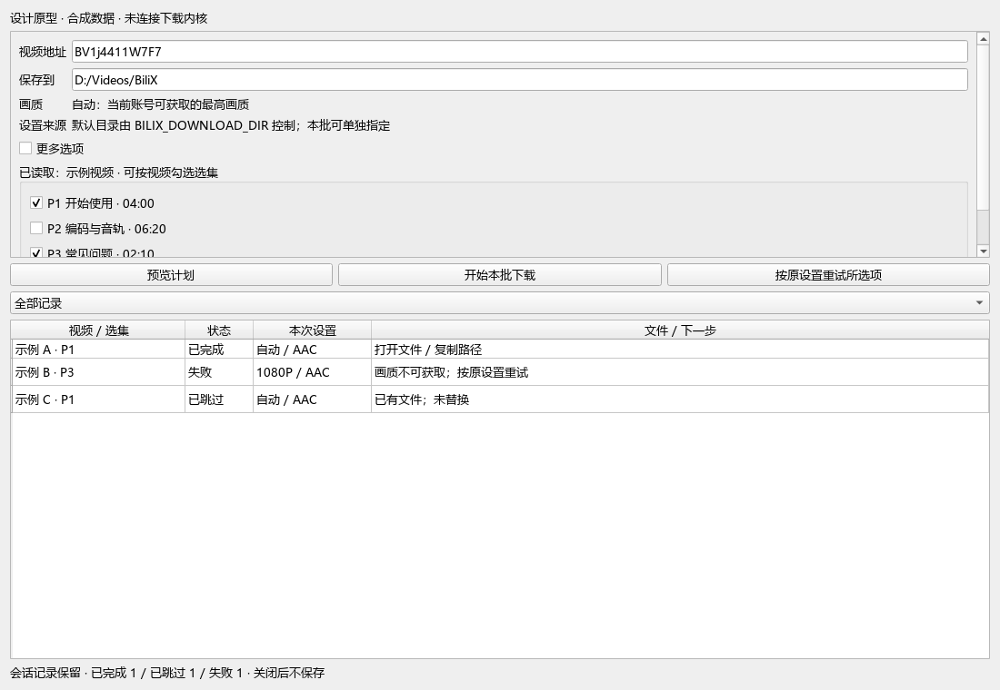
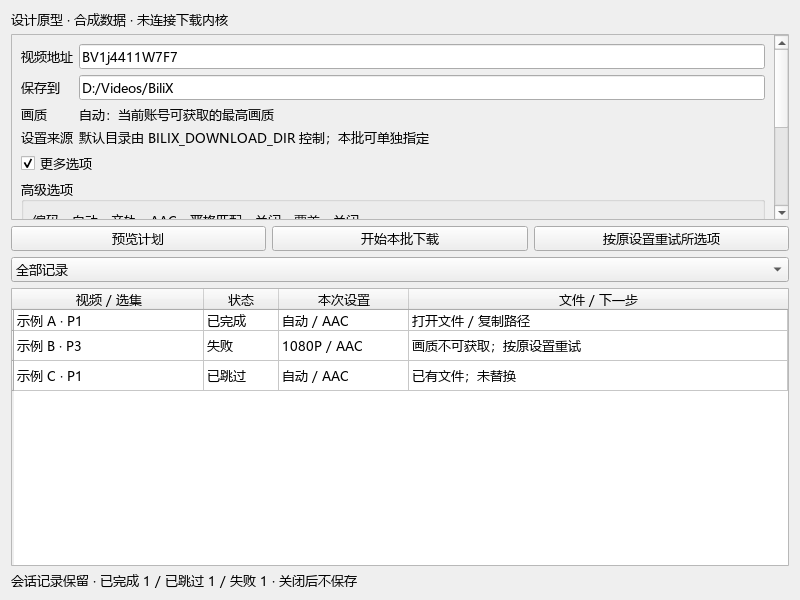

# 1.7 开发指南设计验证

日期：2026-10-05（Asia/Shanghai）。源码基线：`7c48649a88e3ecacc999ca741c494df60ea5f812`；被测产品源码版本 **1.6.0**。工作树含本轮指南、索引/测试规范、原型和契约实验测试的未提交修改。**这是设计验证，不是 1.7.0 的发行、功能完成或真实桌面验收。**

## 1. 身份、环境与证据

- Windows 10 build 19045，CPython 3.14.8。
- GUI 环境：PySide6-Essentials/shiboken6 6.11.2、pytest-qt 4.5.0、pytest 9.1.1、Ruff 0.15.22。
- 使用仓库中既有审计环境 `build/gui-audit-python3148/venv` 与无 Qt 的 `build/validation-cli-env`；没有重建 wheel 或原生包。
- 显式 `PYTHONPATH=src`，已检查实际 djhx_bilix 导入位于本仓库 src，CLI 版本为 1.6.0。这两个既有环境的发行元数据仍报告 djhx-bilix 1.3.2；本轮不是该旧发行版测试，也不是锁定环境重新安装或最终 wheel 验证。正式候选须重建锁定/隔离环境并核验最终包。
- 最终原型 SHA256：`60453d63ea65a4090c5476e404acfaf444d5efb7ddbde6941159ff3f5eb05386`，脚本为 [ux_17.py](../scripts/prototypes/ux_17.py)。修改脚本后须重新运行，不能沿用此哈希结论。
- 原型运行时为 2026-10-05 00:10（北京时间），结果保留 ISO 时区偏移；日志目录名中的 Z 时间按 UTC 解释。
- 全部账号/下载测试使用隔离 profile 和合成响应，未读取日常 token。原型对 curl_cffi Session.request 装入禁止联网的 mock，记录调用次数为 **0**。

本地原始证据（build 为忽略目录，不随 clone 分发；下面的文件名用于本轮定位，公共结论由本文保留）：

| 范围 | 本地目录 |
| --- | --- |
| 原型结果/截图 | `build/ux-17-prototype-20261005-01/`：result.json 和三个 layout PNG |
| 全量 GUI profile | `build/validation/1.6.0/gui-20261004T161027Z-9c2513b5/`：result.json、pytest.xml、各步骤日志 |
| 无 Qt CLI profile | `build/validation/1.6.0/cli-20261004T161156Z-cf9a5cbc/`：result.json、pytest.xml、各步骤日志 |

## 2. 实际执行结果

| 检查 | 结果 | 证明范围 |
| --- | --- | --- |
| GUI profile，--strict-skips | **269 passed，0 failed，0 errors，0 skipped** | 当前源码全部离线回归，其中含 17 项纯 Python 设计契约实验；Ruff、文档链接、CLI 入口/诊断/纠错/补全、GUI smoke 均通过 |
| CLI profile，--strict-skips，Qt 不可导入 | **249 passed，0 failed，0 errors，0 skipped** | 排除 tests/gui 的源码回归，含设计纯逻辑；没有把 Qt 缺失当作整组 GUI 通过 |
| 原型契约初次单独执行 | **17 passed** | 身份/尝试、快照、事件、冲突、来源选择、输入行号、速率重置；最终源码随后纳入上述全量 profile |
| CLI 帮助检查（前轮，同一产品源码） | 根/download/info：退出 0，stderr 空，stdout 有帮助 | GNU 风格显式帮助语义已经满足，不属于待修复缺陷 |
| 原型高级面板开/关 | 显示/隐藏均符合勾选状态 | 仅原型 widget 交互 |
| 原型筛选 | 三行 → 一条失败行 → 三行恢复 | 仅示意表格模型切换，未连接任务调度 |
| 最终文档相对文件链接 | 27 份 Markdown、185 个相对文件链接通过 | 文件目标存在；跨文档指向指南的标题锚点已单独核对 |
| 范围/依赖索引检查 | 10 个 A、7 个 B、5 个 D 定义唯一，A 的 roadmap 索引齐全 | 检查重复/遗漏与锚点，不自动证明所有自然语言要求一致 |
| 工作树 whitespace | git diff --check 通过 | 不代表语言或设计内容已自动证明一致 |

269 与 249 不能相加作为互不重叠用例总数，两个 profile 大量共用内核/CLI 测试。GUI profile 中的新增 17 项是设计实验，不是 17 项已完成产品功能。

## 3. 对当前产品行为的可执行复现

原型导入真实 MainWindow，但把下载与启动后台操作替换为 mock，仅向表格注入合成状态：

| 实验 | 实测 | 指南决策 |
| --- | --- | --- |
| 准备一条完成、一条失败，然后调用 _retry_failed | 重试前 2 行，之后 1 行 | A-03 必须保留成功记录，预览/重试不清表 |
| 重试前把当前画质改为 1080P | 捕获的重试 options.quality 为 80 | 现有行为读取当前表单；目标默认复用失败尝试快照 |
| 设置文件目录与 BILIX_DOWNLOAD_DIR 不同 | save_settings 返回文件目录；重新 load_settings 返回环境目录 | A-06 必须区分文件值/有效默认/任务覆盖 |
| 上述窗口复现 | 没有调用下载操作 | 不包含真实视频、网络、媒体传输或线程竞态证据 |

这不是对完整下载流程的模拟，也不证明 GUI 其他交互已经通过真实桌面。

## 4. 设计契约原型覆盖

[实验测试](../tests/prototypes/test_ux_17.py)有 17 个展开后的参数化用例，验证以下不变量：

- 多批次记录不覆盖，task_id 跨重试稳定；新尝试归新批次，旧尝试快照保留。
- 原设置指被重试尝试；显式当前设置仅改新尝试，后续默认重试复用该次设置。
- 重复终态、旧尝试与旧序号不改写新结果；未来尝试/非法阶段拒绝。
- 状态筛选不删除记录，成功项不能进入失败重试。
- 目标不存在/文件/目录的冲突估计不写入或覆盖；覆盖开关映射 skip/replace。
- 配置原型同时保留 file_value 与 effective/source，空环境按当前 loader 视为无覆盖。
- 输入原型保留 BOM/注释后的实际行号和重复项，非法行的提示带原行号。
- 双流已知长度才产生传输 ETA；未知长度无 ETA；字节回退/流尝试变化重置窗口，无负速率/陈旧 ETA。

限制：

- Session 只是不可变记录实验，不是 scheduler，没有来源发现、真实 runner、队列追加/任务取消或完整批次汇总。
- 输入原型用异常演示非法行号；产品 B-05 的逐项失败后继续处理策略尚未实现，不能把此测试当作批处理完成。
- Setting 只验证来源表示，不代替完整 TOML 键级写入/校验服务。
- Rate 使用受控 monotonic 样本，不模拟 curl 重试与网络抖动；当前生产进度没有流尝试字段。
- 原型按钮只是界面示意。实际可操作的是高级开关与筛选，不是信息加载、选集解析或真实重试。

## 5. 布局与规模探查

截图尺寸实际为 1100×760、800×600 基本模式、800×600 高级模式。都使用 Qt offscreen 与合成数据，人工查看截图；输入/选集区可滚动，主动作、筛选、表格、状态摘要保持可见。原型未定稿：大窗口的选集区仍使用滚动，正式设计需调整信息/队列空间分配，并验证滚动焦点和长文字。

本机 offscreen 默认字体不能显示中文，首轮出现方框；最终原型显式加载系统 Microsoft YaHei 后重渲染。没有复制或分发字体；这不是原生桌面字体回退/IME/DPI 已通过的证据。





模型替换 + 滚到底部 + 一次 processEvents 的五次探查：

| 合成行数 | 五次耗时（ms） | 中位（ms） |
| --- | --- | --- |
| 100 | 3.978、2.332、2.295、3.130、2.303 | 2.332 |
| 1000 | 2.650、2.539、2.534、3.568、4.226 | 2.650 |

这只支持继续试验模型/视图方案，不能推断下载性能提升、千项真实队列延迟、内存峰值或最终 SLA；也不能由 1000 行略高/略低的小样本认定扩展复杂度。没有与 1.6.0 控件基线比较，不据此强制迁移 QTableWidget。

## 6. 复现方式

从源码根目录建立锁定环境，避免沿用本轮元数据旧的审计环境：

```shell
uv sync --locked --extra gui --group gui-test
uv run --locked --extra gui --group gui-test python scripts/validate.py --profile gui --strict-skips
uv run --locked --extra gui --group gui-test python scripts/prototypes/ux_17.py --output build/ux-17-prototype-local-001
```

原型输出必须是新目录，重复执行先改成新的编号；脚本拒绝覆盖旧目录。输出包括源码提交/工作树、脚本哈希、Python/Qt/平台、联网调用数、行为复现、交互结果、截图与探查样本。纯逻辑实验可以在无 Qt 环境运行：

```shell
uv run --locked python -m pytest -q --ignore=tests/gui tests/prototypes/test_ux_17.py --basetemp build/ux-17-contract-temp-001
```

pytest basetemp 必须选择新的专用目录，不能指向已有下载、配置或证据目录；Windows 使用绝对路径或已确认在 workspace/build 下的路径。本轮使用随机新目录，无清理已有证据。CLI 无 Qt profile 须另建不含 gui extra 的隔离环境，不以同一 GUI 环境的 CLI 检查代替。

## 7. 未验证与开发结论

未验证：正式 A/B 实现、跨端 runner、来源失败/真实选集变动、实际登录/权限/视频下载、线程与提交竞态、原生 DPI/中文输入法/屏幕阅读、Windows 升级降级/写入后恢复、Linux/其他 Python 安装、最终 wheel/deb/exe/安装器与公开分发。1.6.0 历史发行证据仍在[原记录](validation-1.6.0.md)。

支持的设计结论：最小任务/尝试模型先于记录和重试；保留会话记录与运行中追加分开；快照与配置来源分开；未知或重试中的 ETA 需明确契约；桌面/业务/升级是正式候选门槛。没有把实验成功转换成产品完成承诺。最终开发范围、依赖与未来用例以[指南](cli-gui-ux-review.md)为唯一来源。
